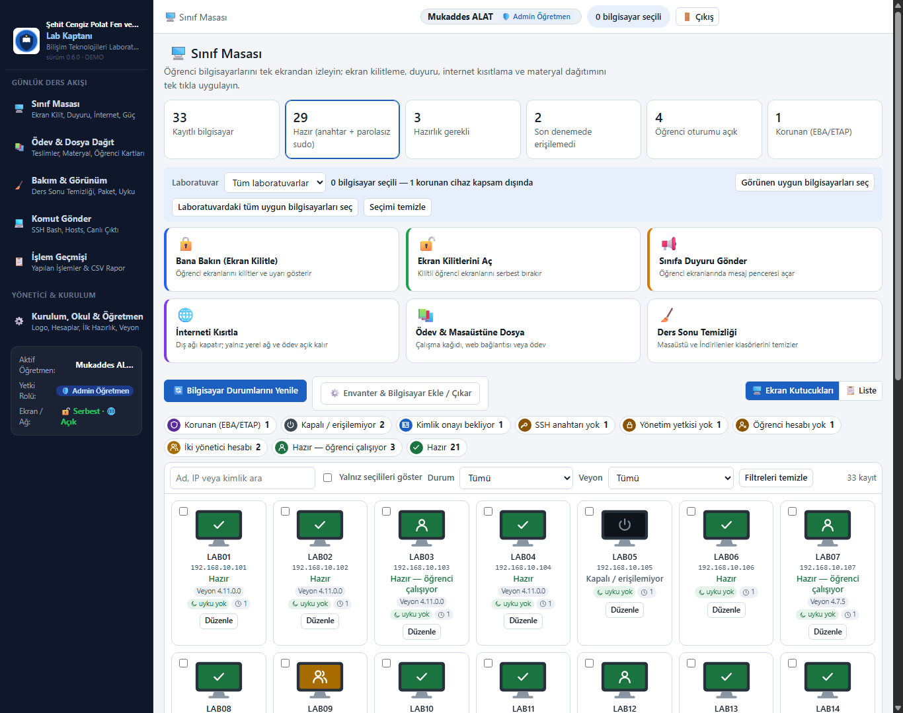

<p align="center">
  
</p>

<h1 align="center">Lab Kaptanı</h1>

<p align="center">
  <strong>Pardus Sınıf Yönetimi (Sürüm 0.7.0)</strong><br>
  Pardus ve Debian tabanlı okul bilgisayar laboratuvarları için teknik bilgi gerektirmeyen, Türkçe ve modern merkezi yönetim uygulaması.
</p>

<p align="center">
  
  
  
  
</p>

---

<p align="center">
  
</p>

<p align="center">
  <sub>Öğretmen paneli Sınıf Masası: tek ekrandan tüm laboratuvar durumu, canlı kontrol araçları ve bilgisayar filtreleri.</sub>
</p>

---

## 🌟 Neler Yapar?

Lab Kaptanı, öğretmenlerin teknik detaylarla vakit kaybetmeden dersi verimli şekilde yürütmelerini sağlar. Öğretmen bilgisayarına tek bir `.deb` paketiyle kurulur; **öğrenci bilgisayarlarına hiçbir ajan veya istemci yazılımı kurulması gerekmez**. Tüm işlemler güvenli SSH anahtarı üzerinden gerçekleştirilir.

* 🖥️ **Canlı Sınıf Masası:**
  * **Bana Bakın (Ekran Kilitle):** Öğrenci ekranlarını tek tıkla kilitler, dikkat çekici görsel uyarı gösterir ve klavye/fareyi kilitler.
  * **Ekran Kilitlerini Aç:** Kilitli ekranları anında serbest bırakır.
  * **Sınıfa Anlık Duyuru:** Öğrenci ekranlarında öğretmenin yazdığı mesajı pencere olarak açar.
  * **İnterneti Kısıtla / Aç:** Öğrencilerin dış internet erişimini tek tıkla engeller; yerel ağ ve ödev portalını açık tutar.
* 🔍 **Bilgisayar Durumları ve Cihaz Detay Özeti:**
  * Bilgisayarlar durum renkleriyle izlenir (Hazır, Öğrenci Çalışıyor, Kapalı, Anahtar Gerekli, Yönetim Yetkisi Yok vb.).
  * Herhangi bir bilgisayar kutucuğuna veya adına tıklandığında IP adresi, bağlantı durumu, donanım bilgisi ve Veyon sürümü açılır özet penceresinde görüntülenir.
* 🔑 **Tek Adımda Hazırlık (Parolasız Yönetim):**
  * Öğrenci bilgisayarlarının parolası yalnızca ilk kurulumda bir kez girilir.
  * Güvenli Ed25519 SSH anahtarı kurulur; günlük ders yönetiminde **asla parola sorulmaz**.
  * Fazla yönetici hesapları (`pardus`/`hp`) yedeklenerek güvenle tekilleştirilir.
* 🧹 **Ders Sonu Temizliği ve Profil Yönetimi:**
  * Ders bitiminde Masaüstü ve İndirilenler klasörleri tek tıkla temizlenir.
  * Silinen dosyalar öğrenci bilgisayarında karantinaya alınır; yanlışlıkla silinen ödev veya projeler geri kurtarılabilir.
* ⚡ **Güç ve Uyku Yönetimi:**
  * Bilgisayarların ders esnasında boşta uykuya geçmesi veya kapanması tek tıkla önlenir (yalnızca ekran kararır).
  * Ders çıkış saatine özel bir kezlik veya haftalık zamanlı kapatma planı oluşturulabilir.
* 📚 **Ödev ve Materyal Dağıtımı:**
  * Öğrenci bilgisayarlarının masaüstüne ders materyali veya web bağlantısı gönderilebilir.
  * Öğrenciler `http://ogretmen.lab:8090` adresinden sınıf kodlarıyla ödevlerini tarayıcıdan teslim eder.
  * Öğretmen tüm teslimleri tek tıkla düzenli bir ZIP arşivi olarak indirebilir.
* 💻 **SSH Komut Merkezi:**
  * Kayıtlı kütüphaneden veya özel olarak yazılan Bash komutları tüm sınıfa aynı anda gönderilir; çıktılar canlı olarak izlenir.
  * Tek tıkla `/etc/hosts` dosyasında yerel alan adı eşleştirmesi yapılır.
* 🏫 **Okul Kimliği ve Öğretmen Hesapları:**
  * Okul adı ve okul logosu özelleştirilebilir (Varsayılan: Şehit Cengiz Polat Fen ve Teknoloji AİHL).
  * Laboratuvarı kullanan diğer öğretmenler için Standart Öğretmen hesapları tanımlanabilir; yetkiler sınırlandırılabilir.

---

## 🚀 Hızlı Başlangıç (Öğretmen Bilgisayarı)

### 1. Paketi İndirin ve Kurun

Öğretmen bilgisayarında (Pardus 23 EDU) terminal açarak paketi kurun:

```bash
sudo dpkg -i pardus-sinif-yonetimi_0.7.0_amd64.deb
```

> **Not:** Paket, kendi gömülü Python çalışma ortamını ve gerekli tüm kütüphaneleri taşır. Kurulum için internet bağlantısı gerekmez.

### 2. Uygulamayı Açın

1. Masaüstünde veya uygulama menüsünde bulunan **Lab Kaptanı** simgesine tıklayın.
2. İlk açılışta terminalde verilen kurulum kodunu girerek kendi yönetici giriş parolanızı belirleyin.
3. Giriş yaptıktan sonra **Kurulum, Okul & Öğretmen** menüsünden okul adınızı ve varsa logonuzu kontrol edin.
4. **İlk Hazırlık (SSH & Sudo)** ekranından laboratuvarınızdaki bilgisayarları seçip tek tıkla yönetime bağlayın.

Detaylı rehber için: [Öğretmenler İçin Kullanım Kılavuzu](belgeler/kullanim_kilavuzu.md)

---

## 📖 Belgelendirme

| Belge | Açıklama |
| --- | --- |
| 📘 [Kullanım Kılavuzu](belgeler/kullanim_kilavuzu.md) | Öğretmenler için adım adım, ekran alıntılarıyla hazırlanmış sade rehber. |
| 🛠️ [Yönetici Kılavuzu](belgeler/yonetici_kilavuzu.md) | Sistem yöneticileri için mimari, servisler, veri konumları, portlar ve güvenlik modeli. |
| 📚 [Ödev Kılavuzu](belgeler/odev_kilavuzu.md) | Ödev teslim portalı, sınıf listeleri, öğrenci kartları ve dosya toplama akışı. |
| 📊 [Örnek Sınıf Listesi (CSV)](belgeler/ornek_sinif_listesi.csv) | Öğrenci listelerini içeri aktarmak için şablon dosya (`sınıf;numara;ad soyad`). |

---

## 💻 Geliştirme ve Test

```bash
# Bağımlılıkları yükleyin
pip install -r paketleme/requirements.txt pytest

# Yerel geliştirme sunucusunu başlatın (http://127.0.0.1:8080)
python -m uygulama.ana

# Ödev teslim portalını başlatın (http://0.0.0.0:8090)
python -m uygulama.odev.portal

# Birim ve entegrasyon testlerini çalıştırın
python -m pytest -q testler

# Bağımsız tek dosyalı önizlemeyi güncelleyin
python araclar/onizleme_yap.py

# Belge ekran görüntülerini yeniden üretin
python araclar/belge_gorselleri_uret.py

# Debian kurulum paketi (.deb) üretin
python paketleme/deb_yap.py
```

### Proje Dizin Yapısı

```text
├── uygulama/              # FastAPI arka uç servisleri ve arayüz dosyaları
│   ├── arayuz/            # HTML5, CSS3, modern Vanilla JS arayüz
│   ├── uzak/              # Öğrenci makinelerinde çalışan ajan gerektirmeyen SSH betikleri
│   └── odev/              # Öğrenci ödev teslim portalı ve depolama motoru
├── belgeler/              # Güncel kullanım kılavuzları ve ekran görüntüleri
│   └── gorseller/         # Arayüze ait yüksek çözünürlüklü ekran alıntıları
├── araclar/               # Önizleme ve görsel üretici geliştirme araçları
├── paketleme/             # Saf Python ile yazılmış Debian (.deb) paketleyicisi
└── testler/               # 200+ birim ve entegrasyon testleri
```

---

## 📄 Lisans

Bu proje **GNU General Public License v3.0 or later (GPL-3.0-or-later)** ile lisanslanmıştır. Detaylar için [LICENSE](LICENSE) dosyasına bakabilirsiniz.
