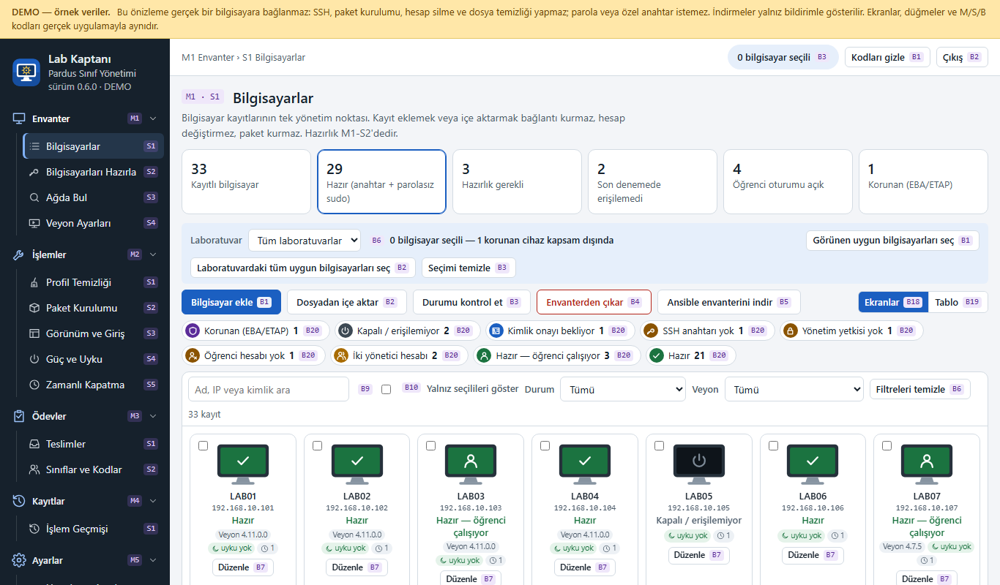
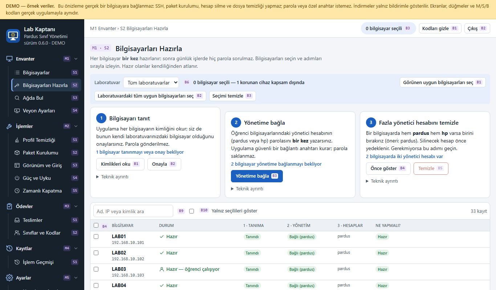
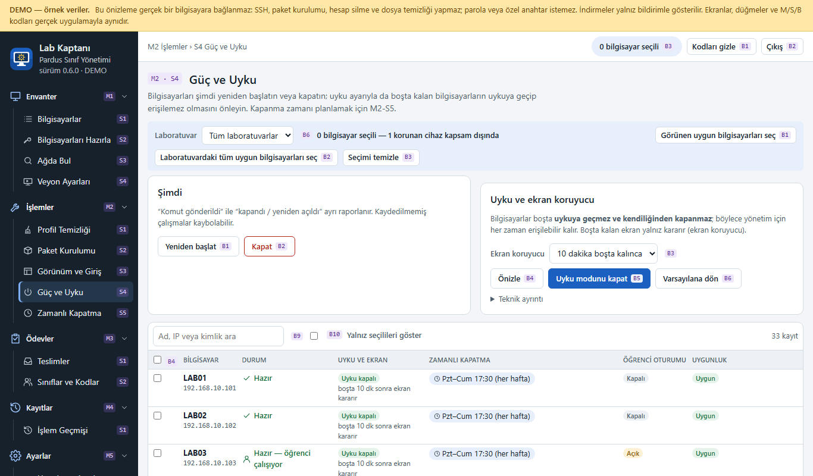
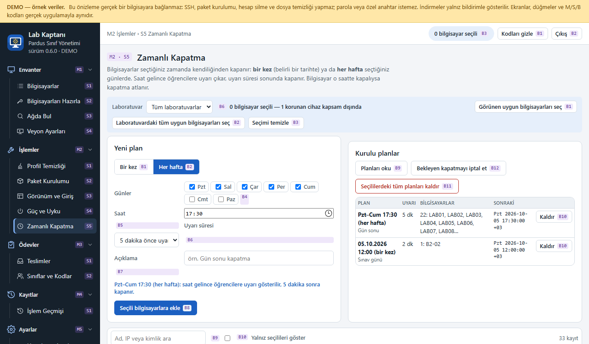

<p align="center">
  
</p>

<h1 align="center">Lab Kaptanı</h1>

<p align="center">
  <strong>Pardus Sınıf Yönetimi</strong> — Pardus kullanan okul laboratuvarları için teknik bilgi
  gerektirmeyen, Türkçe merkezi yönetim uygulaması.
</p>

<p align="center">
  
  
  
</p>

Öğretmen bilgisayarına tek bir `.deb` paketiyle kurulur. Öğrenci bilgisayarlarına ajan
kurulmaz; yönetim SSH anahtarıyla yapılır ve günlük işlerde parola sorulmaz.

<table>
  <tr>
    <td></td>
    <td></td>
  </tr>
  <tr>
    <td></td>
    <td></td>
  </tr>
</table>

<sub>Görüntüler DEMO verisiyle alınmıştır; gerçek bir bilgisayar bilgisi içermez.
Arayüzün tamamını sunucusuz denemek için `arayuz-onizleme.html` dosyasını tarayıcıda açın.</sub>

## Neler yapar?

- **Envanter:** bilgisayarları elle, Ansible envanterinden veya CSV'den ekleyin; her birinin
  durumu renk ve simgeyle görünür (hazır, kapalı, anahtar yok, yetki yok…).
- **Hazırlık:** bir kez parola girilir; her bilgisayara uygulama anahtarı ve doğrulanmış
  parolasız yetki kurulur. Fazla yönetici hesabı (pardus/hp) güvenle tekilleştirilir.
- **Ağda bul:** kendi ağınızdaki SSH açık bilgisayarları bulur; eklemek onaylı bir adımdır.
- **Toplu işlemler:** seçilen bilgisayarlarda profil temizliği, yedekleme ve yedekten dönüş,
  yerel `.deb` kurulumu, giriş ekranı ve görünüm ayarları. Her işlem önce önizlenir ve
  kesin hedef listesiyle onaylanır.
- **Güç:** yeniden başlatma ve kapatma; bilgisayarların boşta uykuya geçmesini önleyen ayar;
  bir kez (`at` gibi) veya her hafta (`cron` gibi) zamanlı kapatma.
- **Veyon:** Veyon Configurator kullanmadan Veyon paketini ve public key'i yükler, seçili
  bilgisayarlara kurar ve anahtar dosyasıyla yapılandırır.
- **Ödev teslimi:** öğrenciler sınıf kodlarıyla ödevlerini yükler; öğretmen takip eder ve ZIP
  olarak indirir (ayrı bir öğrenci portalı üzerinden).

## Hızlı başlangıç (öğretmen bilgisayarı)

1. Pardus 23 yüklü öğretmen bilgisayarında `.deb` dosyasını edinin (aşağıdaki
   [paket üretme](#paket-üretme) bölümü ya da sürüm sayfası).
2. Kurun:

   ```bash
   sudo dpkg -i pardus-sinif-yonetimi_0.6.0_amd64.deb
   ```

3. Masaüstündeki **Lab Kaptanı** simgesiyle açın; ilk açılışta uygulama giriş parolanızı
   belirleyin. Bu parola yalnızca bu uygulamaya girmek içindir.
4. Bilgisayarları ekleyin ve **Bilgisayarları Hazırla** sayfasındaki üç adımı izleyin.

Kullanım adımları için: [İlk kullanım kılavuzu](belgeler/ilk_kullanim_101.md).

## Belgeler

- [İlk kullanım kılavuzu](belgeler/ilk_kullanim_101.md) — öğretmenler için
- [Yönetici kılavuzu](belgeler/yonetici_kilavuzu.md) — kurulum, mimari, veri konumları, kurtarma
- [Ödev Teslim kılavuzları](belgeler/odev_ogretmen_kilavuzu.md) ·
  [öğrenci kılavuzu](belgeler/odev_ogrenci_kilavuzu.md)
- [Arayüz referans haritası](belgeler/arayuz_referans_haritasi.md) — her menü, sayfa ve düğmenin
  sabit M/S/B kodu
- [Tasarım belirteçleri](DESIGN.md) · [Değişiklik günlüğü](CHANGELOG.md)
- [Geliştirme istemleri](belgeler/gelistirme/) — gereksinimler ve karar kayıtları

## Geliştirme

```bash
pip install -r paketleme/requirements.txt pytest
python -m uygulama.ana                 # http://127.0.0.1:8080 (ilk açılışta kurulum kodu günlüğe yazılır)
python -m pytest -q testler            # testler
python araclar/onizleme_yap.py         # arayuz-onizleme.html ve docs/demo/ üretilir
python araclar/referans_haritasi.py    # belgeler/arayuz_referans_haritasi.md üretilir
```

Öğrenci portalı ayrı bir süreçtir: `python -m uygulama.odev.portal` (varsayılan port 8090).

Dizinler:

| Dizin | İçerik |
| --- | --- |
| `uygulama/` | Python (FastAPI) arka ucu ve Türkçe web arayüzü |
| `uygulama/uzak/` | Öğrenci PC'de çalışan, izin listeli uzak betikler |
| `uygulama/odev/` | Ödev Teslim: öğrenci portalı (ayrı süreç) ve öğretmen uçları |
| `araclar/` | Üretici betikler (belirteç CSS, referans haritası, önizleme) ve geliştirme sunucusu |
| `paketleme/` | `.deb` üreticisi, sabit bağımlılıklar, servis ve bakım betikleri |
| `testler/` | Otomatik testler |
| `belgeler/` | Kılavuzlar, referans haritası ve geliştirme istemleri |
| `docs/` | GitHub Pages sayfası ve canlı önizleme (`docs/demo/`) |

## Paket üretme

`.deb` dosyası saf Python ile üretilir (`dpkg-deb` gerekmez); Pardus 23 üzerinde derlemek
en tekrarlanabilir sonucu verir:

```bash
python paketleme/deb_yap.py
```

Çıktı: `cikti/pardus-sinif-yonetimi_<sürüm>_amd64.deb` (+ `.sha256`). Gömülü Python ve
kütüphane tekerlekleri her derlemede sabit SHA-256 değerleriyle doğrulanır. Ayrıntılar:
[yönetici kılavuzu](belgeler/yonetici_kilavuzu.md).

Kaldırma: `sudo apt remove pardus-sinif-yonetimi` (veriler korunur);
tam silme: `sudo apt purge pardus-sinif-yonetimi`.

## Güvenlik

Bu uygulamanın güvenlik modelini ve bilinen sınırlarını **[SECURITY.md](SECURITY.md)**
dosyasında bulabilirsiniz. Özet:

- Yönetim hesaplarına parolasız sudo (`NOPASSWD: ALL`) verilir; bu, anahtara sahip olanın
  öğrenci bilgisayarlarında **root eşdeğeri** yetkiye sahip olması demektir. Öğretmen
  bilgisayarının güvenliği laboratuvarın güvenliğidir.
- Hazırlık parolaları yalnızca işlem sırasında bellekte tutulur; kaydedilmez.
- Yönetim arayüzü yalnızca `127.0.0.1` üzerinde dinler. Ağa açık tek bileşen öğrenci
  portalıdır ve düz HTTP kullanır (laboratuvar ağında şifresiz; belgelenmiş bir karardır).

Güvenlik açığı bulursanız lütfen herkese açık issue açmak yerine SECURITY.md'deki özel
bildirim yolunu kullanın.

## Katkıda bulunma

Katkılar memnuniyetle karşılanır. Geliştirme ortamı, test ve referans kodu kuralları için
**[CONTRIBUTING.md](CONTRIBUTING.md)**; davranış kuralları için
**[CODE_OF_CONDUCT.md](CODE_OF_CONDUCT.md)** dosyasına bakın.

## Yol haritası ve bilinen sınırlar

- XFCE bilgisayarlar için GNOME geçişi uygulanmaz; yalnızca tespit edilip kapsam dışı gösterilir.
- Ödev Teslim 2. aşaması: öğrenci PC'lerine `ogretmen.lab` ad kaydı ve kısayol dağıtımı,
  aktif yükleme sırasında profil sıfırlama uyarısı, 40 eşzamanlı öğrenci yük testi.
- Giriş ekranında yönetim hesabının gizlenmesi AccountsService üzerinden doğrulanır; gerçek
  giriş ekranı görsel olarak henüz doğrulanmadı.
- Veyon'da gerçek anahtarlı oturum yalnızca Veyon Master'da denenebilir; bu uygulama
  private key'i bilerek tutmaz.
- LightDM ve XFCE desteklenmiyor.

## Lisans

Bu proje [GNU Genel Kamu Lisansı sürüm 3 veya sonrası](LICENSE) (GPL-3.0-or-later) ile
lisanslanmıştır. Kullandığı üçüncü taraf bileşenlerin (FastAPI, Paramiko, Pydantic,
cryptography, Uvicorn ve diğerleri) lisansları kendi dağıtımlarında geçerlidir.
Pardus ve Veyon bu depoya dahil değildir; uygulama onlarla birlikte çalışır.

## English summary

**Lab Kaptanı** (package `pardus-sinif-yonetimi`) is a Turkish-language management tool for
school computer labs running Pardus 23. The teacher's computer runs the app from a single
`.deb`; student computers get no agent, and management happens over SSH with a key that is
set up once. It covers inventory with status colors, one-time setup, Veyon deployment,
power and sleep settings, scheduled shutdowns, cleaning and restore, and homework submissions.
The UI and documentation are in Turkish. Licensed under GPL-3.0-or-later.
