# Lab Kaptanı (Pardus Sınıf Yönetimi) — Öğretmen ve Laboratuvar Kullanım Kılavuzu

Bu kılavuz, bilgisayar laboratuvarını yöneten öğretmenler ve sistem yöneticileri için hazırlanmıştır. **Lab Kaptanı**, karmaşık komut satırı işlemleri veya teknik zorluklar olmadan; canlı ders akışını, ödev dağıtım ve toplama işlemlerini, bilgisayar bakım ve güç kontrollerini, hazır komut mağazasını ve laboratuvar kurulumunu tek ekrandan yönetmenizi sağlar.

---

## 📌 İçindekiler
1. [Sistem Kurulumu ve Giriş](#1-sistem-kurulumu-ve-giriş)
2. [Arayüz Yerleşimi ve Menü Mimarisi](#2-arayüz-yerleşimi-ve-menü-mimarisi)
3. [GÜNLÜK DERS AKIŞI](#3-günlük-ders-akışı)
   - [3.1. 🖥️ Sınıf Masası ve Canlı Kontroller](#31-️-sınıf-masası-ve-canlı-kontroller)
   - [3.2. 📚 Ödev & Dosya Dağıt (Ödev Portalı ve Klasör Yönetimi)](#32--ödev--dosya-dağıt-ödev-portalı-ve-klasör-yönetimi)
   - [3.3. 📇 Sınıf Listeleri ve Öğrenci Kod Kartları](#33--sınıf-listeleri-ve-öğrenci-kod-kartları)
   - [3.4. 🧹 Bakım & Güç Yönetimi](#34--bakım--güç-yönetimi)
     - [Ders Sonu & Tarayıcı Temizliği](#-ders-sonu--tarayıcı-temizliği)
     - [Güç ve Uyku Ayarları (Uyku Kilidi)](#-güç-ve-uyku-ayarları-uyku-kilidi)
     - [Zamanlı Kapatma Planı](#-zamanlı-kapatma-planı)
4. [ARAÇ KUTUSU](#4-araç-kutusu)
   - [4.1. 🏪 Komut Mağazası & Araçlar](#41--komut-mağazası--araçlar)
   - [4.2. 📦 Yazılım Kurulumu (.deb Paket Merkezi)](#42--yazılım-kurulumu-deb-paket-merkezi)
   - [4.3. 🖼️ Masaüstü Görünümü ve Duvar Kâğıdı Galerisi](#43-️-masaüstü-görünümü-ve-duvar-kâğıdı-galerisi)
5. [YÖNETİCİ & KURULUM](#5-yönetici--kurulum)
   - [5.1. 📜 İşlem Geçmişi ve Raporlama](#51--işlem-geçmişi-ve-raporlama)
   - [5.2. 🏫 Okul Kimliği ve Öğretmen Hesapları](#52--okul-kimliği-ve-öğretmen-hesapları)
   - [5.3. 🔑 Bilgisayar Kurulum Sihirbazı (4 Adım)](#53--bilgisayar-kurulum-sihirbazı-4-adım)
   - [5.4. 💾 Yedekleme ve Başka Bilgisayara Taşıma](#54--yedekleme-ve-başka-bilgisayara-taşıma)

---

## 1. Sistem Kurulumu ve Giriş

Lab Kaptanı yalnızca **öğretmen bilgisayarına** tek bir Debian paketi (`.deb`) olarak kurulur. Öğrenci bilgisayarlarına herhangi bir ajan veya istemci yazılımı yüklenmesine gerek yoktur; yönetim Pardus'un yerleşik SSH altyapısı üzerinden güvenle yürütülür.

```bash
sudo dpkg -i pardus-sinif-yonetimi_0.8.2_amd64.deb
```

Kurulum tamamlandığında arka plan servisi otomatik başlar. Masaüstünüzdeki **Lab Kaptanı** simgesine tıklayarak veya tarayıcınızdan `http://localhost:8081` adresine giderek yönetim panelini açabilirsiniz.

* **Varsayılan Yönetici:** Sistemde tam yetkili `admin` hesabı hazırdır (varsayılan öğretmen adı: **Mukaddes ALAT**).
* **Parola Belirleme:** İlk girişte veya kurulum koduyla belirlenen yönetici parolası yalnızca bu panele giriş içindir; öğrenci bilgisayarlarının şifreleriyle karışmaz.

---

## 2. Arayüz Yerleşimi ve Menü Mimarisi

Lab Kaptanı, öğretmenlerin ders esnasında aradıkları fonksiyona en hızlı şekilde ulaşabilmeleri için 3 ana çalışma grubuna ayrılmıştır:

1. **GÜNLÜK DERS AKIŞI:** Ders esnasında sürekli elinizin altında olması gereken ekranlar (**Sınıf Masası**, **Ödev & Dosya Dağıt**, **Bakım & Güç**).
2. **🧰 ARAÇ KUTUSU:** Sık kullanılan teknik araçlar ve özelleştirmeler (**Komut Mağazası**, **Yazılım Kurulumu**, **Masaüstü Görünümü**).
3. **🏛️ YÖNETİCİ & KURULUM:** Okul yöneticisi ve laboratuvar sorumlusu öğretmenler için derin yapılandırma ekranları (**İşlem Geçmişi**, **Okul ve Öğretmenler**, **Bilgisayar Kurulumu**, **Yedek ve Taşıma**).

Sağ üst köşedeki **⚙️ Gelişmiş Görünüm** butonu ile teknik ayrıntıları gizleyebilir ya da tek tıkla görünür hale getirebilirsiniz.

---

## 3. GÜNLÜK DERS AKIŞI

### 3.1. 🖥️ Sınıf Masası ve Canlı Kontroller

Sınıf Masası, ders esnasında tüm laboratuvarı tek bakışta izleyip yönlendirebileceğiniz ana kumanda merkezidir.

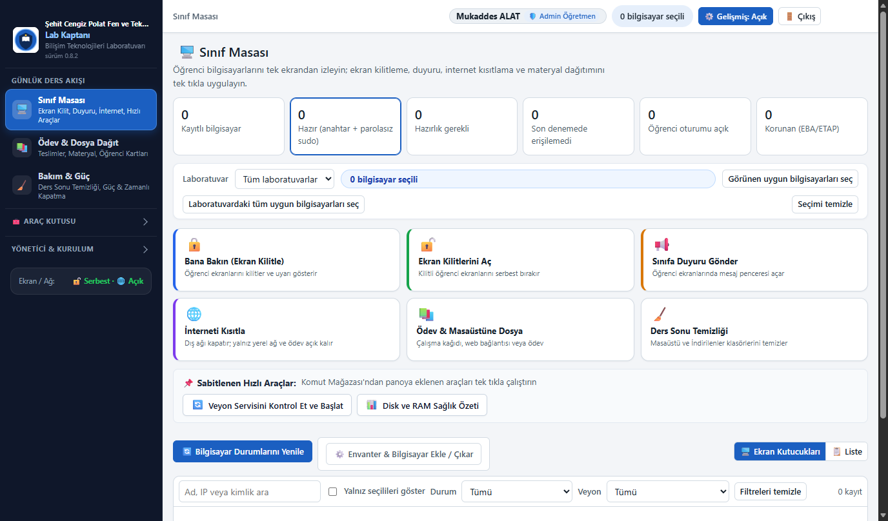

#### Üst Durum Sayaçları
Sayfanın en üstünde kayıtlı bilgisayarlar, yönetime hazır makineler, hazırlık bekleyenler ve açık öğrenci oturumlarının canlı sayıları yer alır.

#### Hızlı Canlı Ders Kontrolleri
* **🔒 Bana Bakın (Ekran Kilitle):** Öğrencilerin dikkatini anında tahtaya toplamak için kullanılır.
  * Seçili tüm öğrenci ekranları anında kararır; klavye ve fare girişi kilitlenir.
  * **Uzaktan Okunabilir Numara Rozeti:** Ekranın sağ üst köşesinde devasa büyüklükte bilgisayar numarası (örn. `ogrenci03` için **`03`**) ve ortada yüksek kontrastlı kimlik kartı belirir. Öğretmen kürsüden dahi hangi masada hangi bilgisayarın olduğunu net bir şekilde görür.
  * Monitörlerin uykuya geçmesi donanımsal (DPMS) düzeyde engellenir.
* **🔓 Ekran Kilitlerini Aç:** Anlatım tamamlandığında ekranları anında serbest bırakır; öğrenci kaldığı yerden çalışmaya devam eder.
* **📢 Sınıfa Duyuru Gönder (Gelişmiş OSD Katmanı):**
  * Öğrencilere seslenmek yerine ekranda dikkat çekici bir duyuru mesajı gösterir.
  * **Belirgin Tasarım:** Ekranın ortasında beliren koyu lacivert zeminli, kalın altın çerçeveli, büyük puntolu ve megafon simgeli modern bir OSD penceresi açılır ve öğrenciye sesli uyarı çalar.
  * **Otomatik Kaybolma (8 Saniye):** Pencerenin altında `⏱️ 8 saniye sonra kendiliğinden kapanacak` geri sayım sayacı çalışır. Süre dolduğunda pencere öğrenci hiçbir şeye dokunmasa dahi otomatik olarak kapanır. Dileyen öğrenci `Esc` veya `✕ Kapat` ile daha erken kapatabilir.
* **🌐 İnterneti Kısıtla / Aç:** Sınavlarda veya dikkat dağıtıcı siteleri engellemek için dış interneti tek tıkla kapatır. Yerel laboratuvar ağı ve ödev teslim portalı açık kalır.
* **📚 Ödev & Masaüstüne Dosya:** Doğrudan dosya ve bağlantı dağıtım ekranına yönlendirir.
* **🧹 Ders Sonu Temizliği:** Hızlı temizlik sekmesini açar.
* **⚡ Sabitlenen Hızlı Araçlar Panosu:** Komut Mağazasından panoya sabitlediğiniz araçlar tek tıkla çalıştırılmak üzere burada buton olarak yer alır.

---

### 3.2. 📚 Ödev & Dosya Dağıt (Ödev Portalı ve Klasör Yönetimi)

Öğrencilere materyal dağıtmak ve ödev toplamak için internet bağlantısına ihtiyaç yoktur; yerel laboratuvar ağı üzerinden son derece hızlı çalışır.

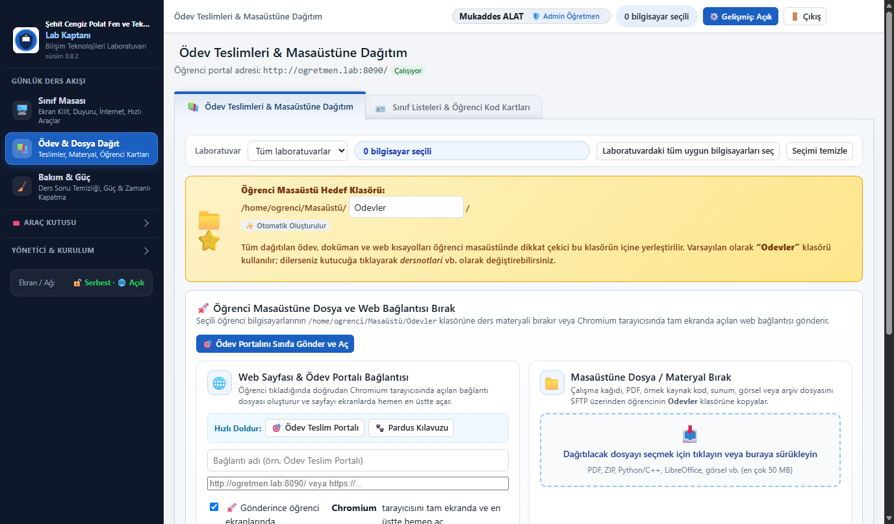

#### Öğrenci Masaüstü Hedef Klasörü Ayarı
* Varsayılan olarak tüm dağıtılan materyaller öğrenci masaüstünde dikkat çekici sarı klasör simgesiyle yer alan `/home/ogrenci/Masaüstü/Odevler` klasörüne bırakılır.
* Öğretmen dilerse bu klasör adını kutucuğa tıklayarak `dersnotlari`, `scratch_projeleri` veya `sinav` olarak özelleştirebilir. Klasör öğrenci bilgisayarlarında otomatik olarak oluşturulur.

#### Dağıtım Seçenekleri
1. **🌐 Web Sayfası & Ödev Portalı Bağlantısı:**
   * Öğrenci tıkladığında doğrudan Chromium tarayıcısında tam ekranda açılan web bağlantı dosyası (`.desktop` ve `.html`) oluşturur.
   * **🎯 Ödev Portalını Sınıfa Gönder ve Aç:** Tek tıkla öğretmen bilgisayarının yerel ağ adresini (`ogretmen.lab:8090`) öğrenci bilgisayarlarına tanıtır ve portalı öğrenci ekranlarında anında açar.
2. **📁 Masaüstüne Dosya / Materyal Bırak (SFTP):**
   * Çalışma kâğıdı, sunum, kod dosyası veya PDF materyallerini sürükleyip bırakarak sınıftaki tüm makinelerin hedef klasörüne güvenli SFTP ile kopyalar.
3. **📋 Ödev Teslimleri ve ZIP İndirme:**
   * Öğrencilerin yerel portaldan yüklediği dosyaları listeler; tek tıkla tüm sınıfın ödevlerini öğrenci adı ve numarasına göre klasörlenmiş tek bir ZIP arşivi olarak indirir.

---

### 3.3. 📇 Sınıf Listeleri ve Öğrenci Kod Kartları

Ödev sayfasındaki ikinci sekme, sınıf mevcudunu sisteme aktarmanızı ve öğrencilere özel teslim kartları basmanızı sağlar.

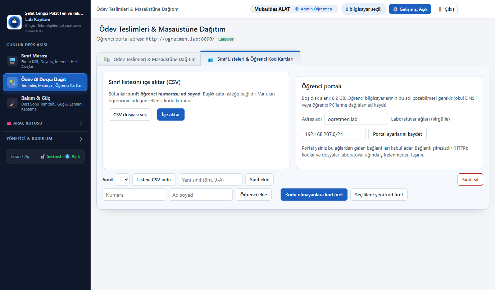

* **CSV ile Sınıf Ekle:** E-Okul veya Excel formatındaki öğrenci listesini (`Numara, Ad Soyad`) tek tıkla yükleyin.
* **8 Haneli Güvenli Teslim Kodu:** Her öğrenciye benzersiz bir teslim kodu üretilir (örneğin `EFE-7429`). Öğrenci portala bu kodla girerek kendi adına ödev yükler.
* **Yazdırılabilir Kod Kartları:** Sene başında veya ders başında kesilip öğrencilere dağıtılmak üzere hazır şablonlu kod kartı çıktısı verir.

---

### 3.4. 🧹 Bakım & Güç Yönetimi

Bakım ve güç işlemleri, tek bir menü çatısı altında 3 pratik sekmeyle (separatör) organize edilmiştir:

#### 1. Ders Sonu & Tarayıcı Temizliği
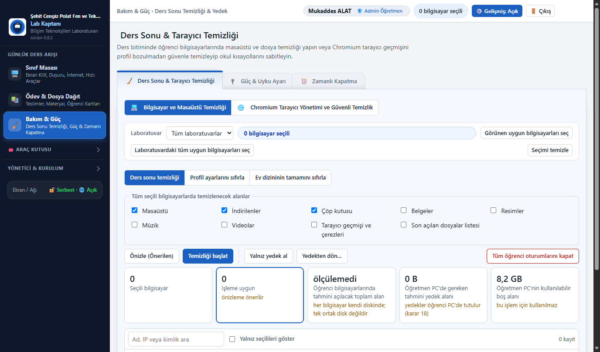
* **Masaüstü & Dosya Temizliği:** Seçili bilgisayarların Masaüstü, İndirilenler, Çöp Kutusu ve Geçici klasörlerini temizler. Silinen dosyalar güvenlik amacıyla öğrenci bilgisayarında yerel karantinaya alınır.
* **Chromium Güvenli Temizlik:** Öğrencilerin açık bıraktığı oturumları, tarayıcı geçmişini ve şifreleri profil ayarlarını bozmadan sıfırlar; okul web kısayollarını yerinde tutar.

#### 2. Güç ve Uyku Ayarları (Uyku Kilidi)
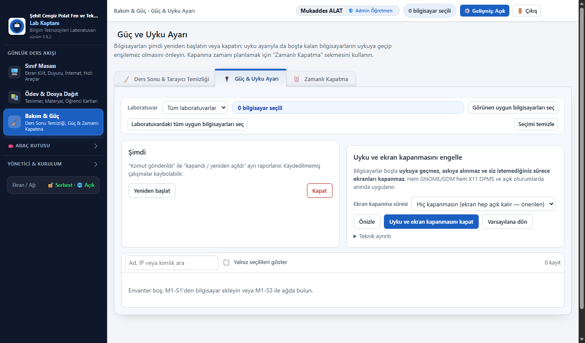
* **Hiç Kapanmasın (Uyku Kilidi):** Bilgisayarlar boşta kalsa dahi uykuya geçmez, askıya alınmaz ve ekranları kararmadan hep açık kalır. Hem GNOME dconf kilitleri hem de X11 DPMS donanımsal koruması ile erişim kopmaları tamamen engellenir.
* **Şimdi Yeniden Başlat / Kapat:** Tek tıkla seçili tüm makineleri anında kapatır veya yeniden başlatır.

#### 3. Zamanlı Kapatma Planı
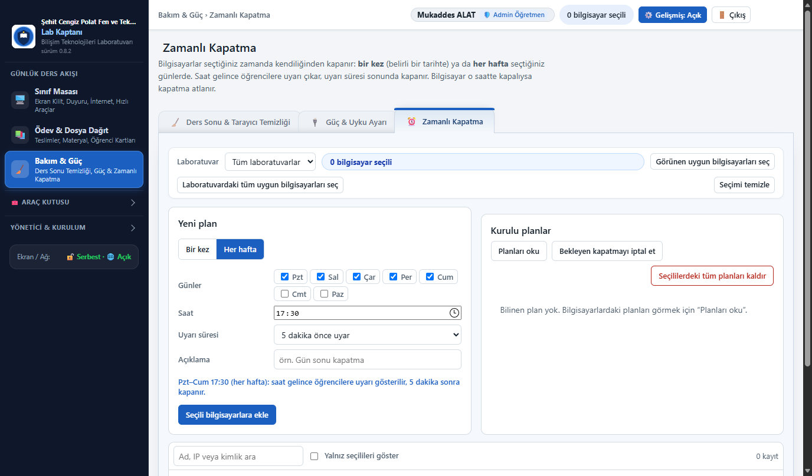
* **Otomatik Kapanma Takvimi:** Hafta içi her gün ders bitiş saatinde (ör. 17:30) veya belirli bir günde bilgisayarların kendiliğinden kapanması için plan oluşturabilirsiniz.
* Kapanmadan 5 dakika önce öğrenci ekranına uyarı bildirimi gönderilir; kayıtlı planlar tablodan tek tıkla iptal edilebilir.

---

## 4. ARAÇ KUTUSU

### 4.1. 🏪 Komut Mağazası & Araçlar

Komut Mağazası, laboratuvar yönetiminde ihtiyaç duyulan özel betikleri ve araçları tek tıkla çalıştırmanızı, öğretmenler arası paylaşmanızı ve resmi GitHub deposundan güncel kalmanızı sağlayan modüldür.

* **Resmi Mağaza Deposu:** [https://github.com/mukaddesalat/pardus_yonet_magaza](https://github.com/mukaddesalat/pardus_yonet_magaza)
* **Git Clone Adresi:** `https://github.com/mukaddesalat/pardus_yonet_magaza.git`
* **Ham Katalog URL:** `https://raw.githubusercontent.com/mukaddesalat/pardus_yonet_magaza/main/katalog.json`

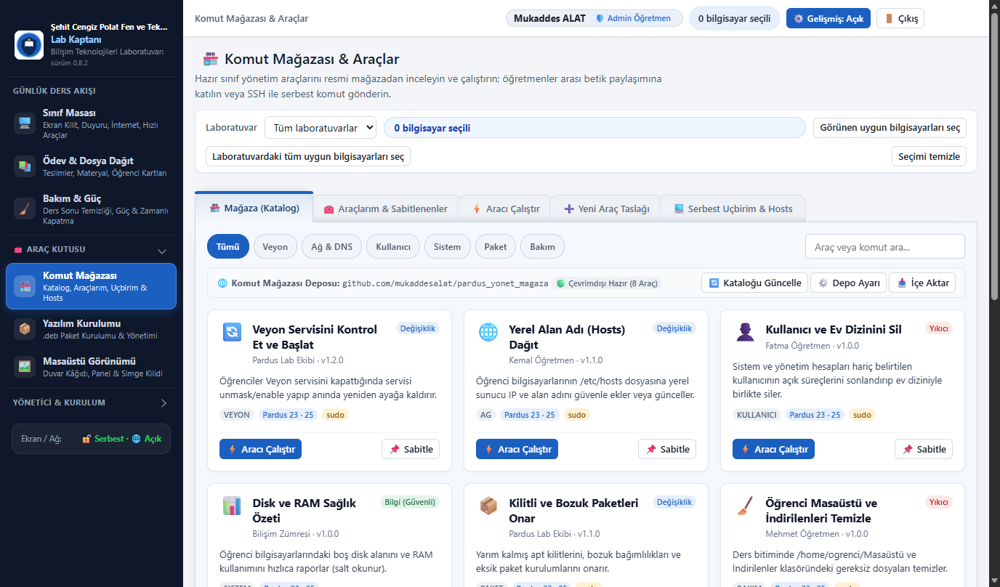

#### 5 İşlevsel Sekme:
1. **🏪 Mağaza (Katalog):**
   * Topluluk ve resmi depodaki tüm hazır araçları kartlar halinde listeler (Veyon servisini ayağa kaldır, Hosts dağıt, Kullanıcı sil, Ağ sıfırla, Paketleri güncelle vb.).
   * Kategori filtreleri (Veyon, Ağ & DNS, Kullanıcı, Sistem, Paket, Bakım) ve anlık arama desteği sunar.
   * **🔄 Kataloğu Güncelle:** GitHub deposundaki son sürüm araçları tek tıkla çeker ve çevrimdışı önbelleğe alır.
2. **🧰 Araçlarım & Sabitlenenler:**
   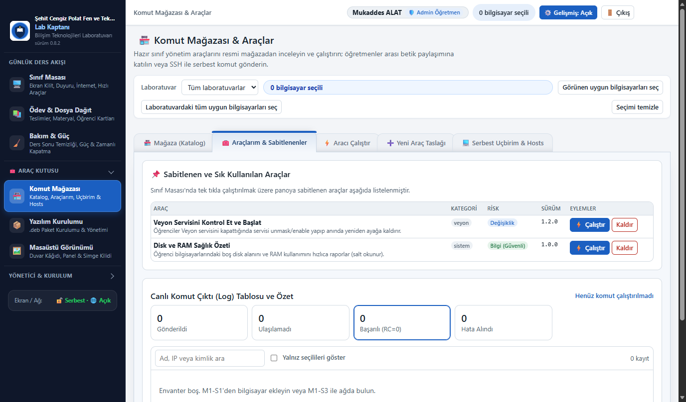
   * Sık kullandığınız araçları bu ekrandan yönetebilir, dilediğiniz araçları **"Sınıf Masası Panosuna Sabitle"** diyerek canlı ders ekranına 1-tık butonu olarak ekleyebilirsiniz.
3. **⚡ Aracı Çalıştır:**
   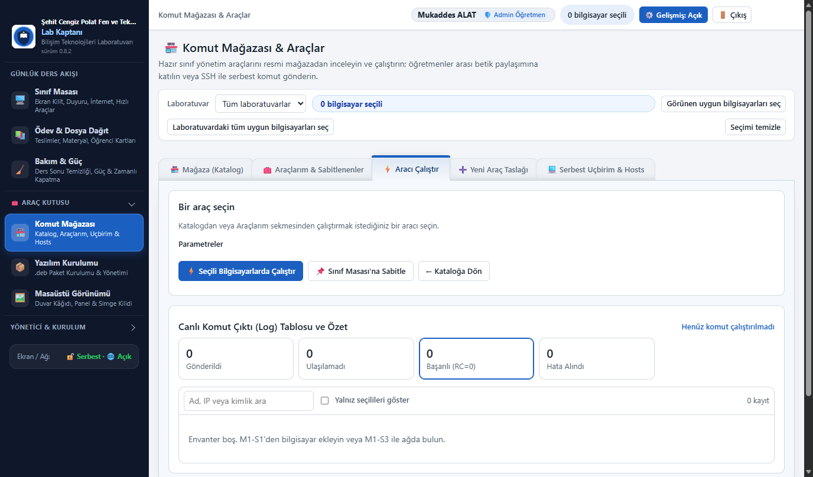
   * Seçilen aracın varsa parametrelerini girip seçili bilgisayarlarda anında çalıştırabilirsiniz.
4. **➕ Yeni Araç Taslağı:**
   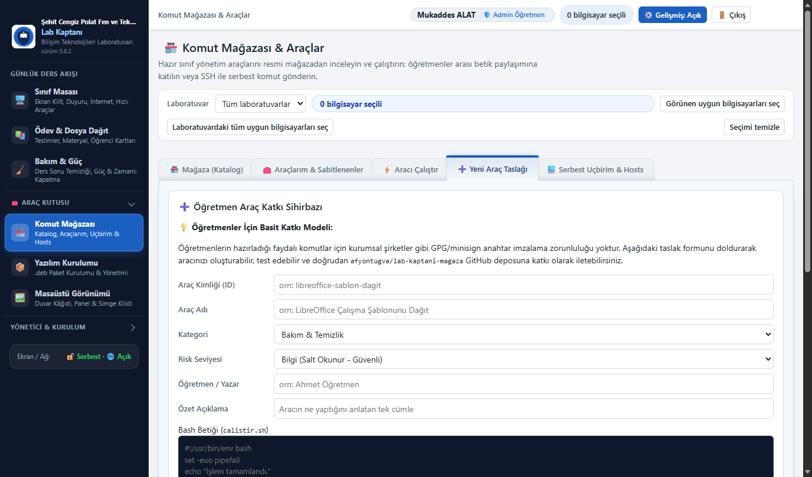
   * Kendi geliştirdiğiniz Bash betiklerini mağaza formatına dönüştürmek için JSON ve betik şablonları sunar.
5. **💻 Serbest Uçbirim & Hosts:**
   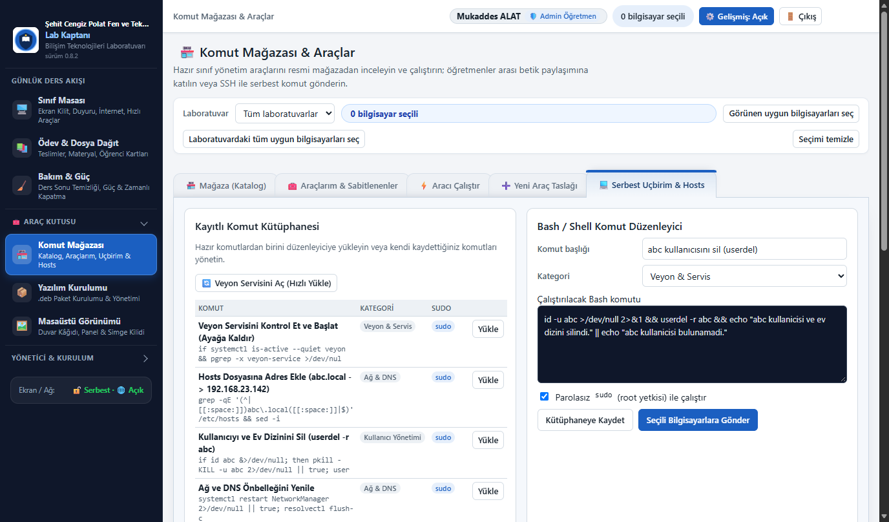
   * Gelişmiş kullanıcılar için seçili bilgisayarlara anlık serbest SSH Bash komutları gönderme ve `/etc/hosts` dosyasını toplu düzenleme imkânı tanır.

---

### 4.2. 📦 Yazılım Kurulumu (.deb Paket Merkezi)

Öğretmen bilgisayarından kalkmadan tüm sınıfa aynı anda `.deb` uygulamaları kurmanızı veya kaldırmanızı sağlar.

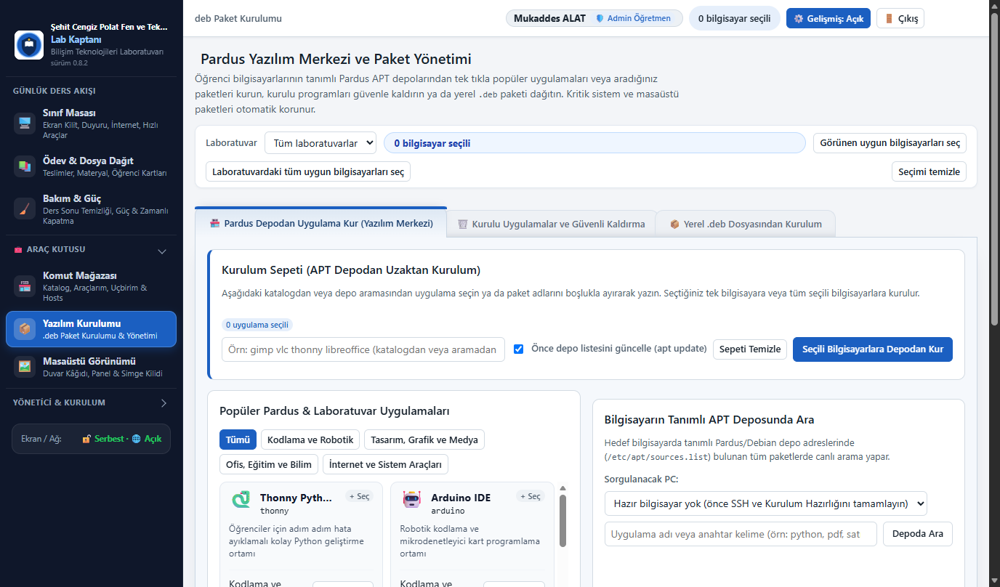

* **Eğitim Vitrini:** Thonny IDE, Scratch, Geogebra, Blender, GIMP, VS Code, Arduino gibi ders yazılımlarını tek tıkla kurun.
* **Yerel `.deb` Yükle:** Bilgisayarınızdaki herhangi bir `.deb` dosyasını sisteme yükleyerek tüm öğrenci bilgisayarlarına toplu dağıtın.
* **Güvenli Paket Kaldırma:** Kritik sistem paketlerinin (`sudo`, `network-manager`, `gdm3`) yanlışlıkla silinmesini önleyen koruma kalkanı mevcuttur.

---

### 4.3. 🖼️ Masaüstü Görünümü ve Duvar Kâğıdı Galerisi

Laboratuvar bilgisayarlarının masaüstü görünümünü tek tıkla kurumsal ve düzenli hale getirir.

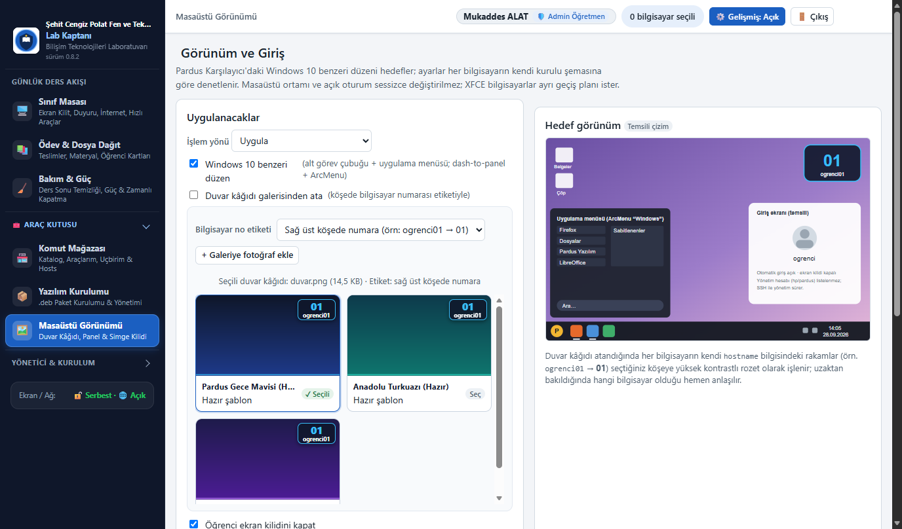

* **Duvar Kâğıdı Galerisi:** Okul fotoğraflarını yükleyin veya hazır Pardus kurumsal temalarını seçin.
* **🏷️ Köşede Bilgisayar Numarası Rozeti:** Duvar kâğıdı atanırken her bilgisayarın adına göre (örn. `ogrenci05` için **`05`**) seçtiğiniz köşeye yüksek kontrastlı numara rozeti otomatik işlenir.
* **Windows 10 Tarzı Panel Düzeni:** Tek tıkla görev çubuğunu alta alır ve başlat menüsünü standartlaştırır.
* **Simge ve Panel Kilidi:** Öğrencilerin masaüstü simgelerini ve panel ayarlarını bozmasını engeller.

---

## 5. YÖNETİCİ & KURULUM

### 5.1. 📜 İşlem Geçmişi ve Raporlama

Laboratuvarda kimin, ne zaman, hangi bilgisayarda ne işlem yaptığını şeffaf bir şekilde denetlemenizi sağlar.

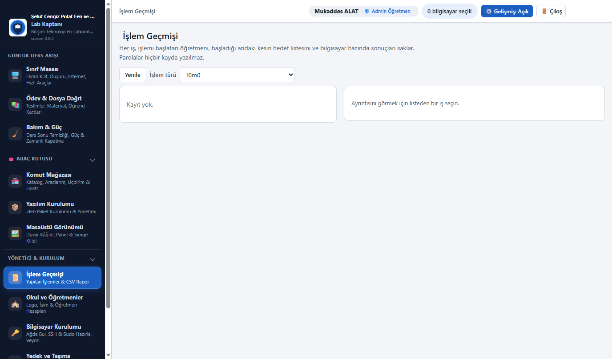

* İşlem türü (paket, güç, temizlik, komut vb.), başlatan öğretmen, hedef makineler ve sonuç kayıt altına alınır.
* Şifreler ve gizli bilgiler hiçbir günlüğe kaydedilmez.
* İstenirse tüm kayıtlar **CSV Raporu** olarak dışa aktarılabilir.

---

### 5.2. 🏫 Okul Kimliği ve Öğretmen Hesapları

Uygulamayı kurumunuza özel hale getirir ve zümre öğretmenleriniz için ayrı hesaplar tanımlar.

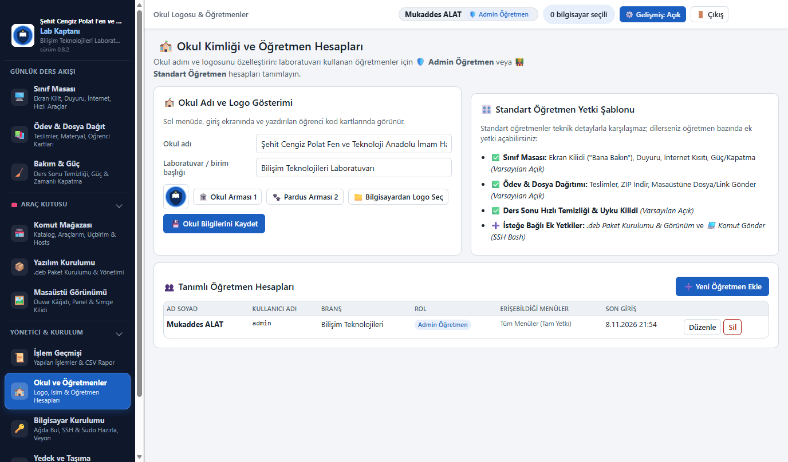

* **Okul Adı ve Logosu:** Giriş ekranında, sol menüde ve kod kartlarında görünecek okul adı ve logosunu ayarlayın.
* **Rol Dağılımı:**
  * **🛡️ Admin Öğretmen:** Tüm teknik ayarlara, yedeklemeye ve kuruluma tam yetkili hesap.
  * **👨‍🏫 Standart Öğretmen:** Yalnızca canlı ders araçları ve ödev modülünü gören, teknik ayarların gizlendiği sade arayüz.

---

### 5.3. 🔑 Bilgisayar Kurulum Sihirbazı (4 Adım)

Laboratuvara yeni bilgisayarlar eklendiğinde **yalnızca bir kez** yürütülen 4 adımlı sihirbazdır. Hazırlık tamamlandıktan sonra günlük derslerde bir daha asla şifre gerekmez.

#### 1. Adım: Ağda Bilgisayar Bul
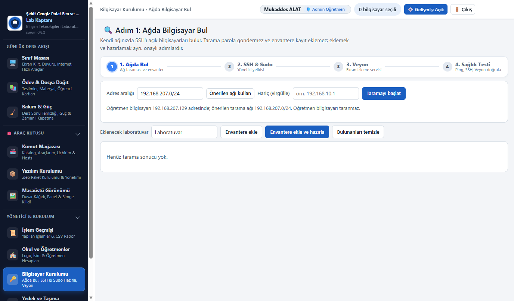
Laboratuvar IP aralığını tarar, açık bilgisayarları tespit eder ve envantere ekler.

#### 2. Adım: İlk Hazırlık (SSH & Sudo)
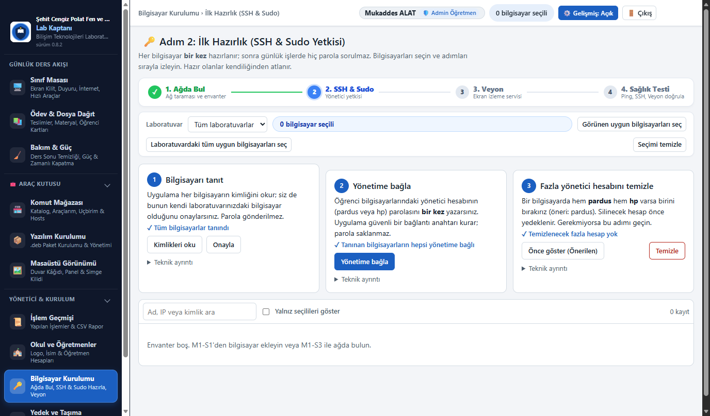
Öğrenci bilgisayarlarındaki varsayılan şifreyi (`pardus` veya `hp`) bir kez girerek Ed25519 yönetim anahtarını kurar, parolasız sudo yetkisi tanımlar ve fazla hesapları tekilleştirir.

#### 3. Adım: Veyon Kurulumu
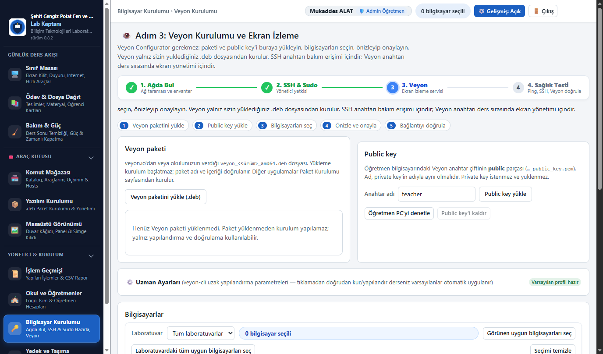
Ders esnasında ekran izleme servisi olan Veyon'u ve yetki anahtarlarını seçili makinelere toplu olarak kurar ve servisi ayağa kaldırır.

#### 4. Adım: Bağlantı Sağlığını Doğrula (Final Sağlık Testi)
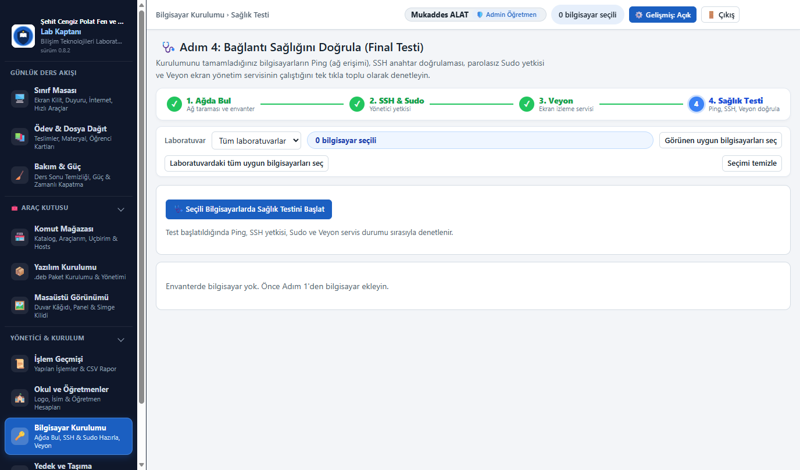
Kurulumu biten tüm bilgisayarların Ağ Erişimi (Ping), SSH Anahtarı, Sudo Yetkisi ve Veyon Servis durumunu tek tıkla test eder; yeşil **"DERS İÇİN HAZIR"** rozetiyle doğrular.

---

### 5.4. 💾 Yedekleme ve Başka Bilgisayara Taşıma

Öğretmen bilgisayarını değiştirdiğinizde veya format attığınızda tüm emeklerinizi tek tıkla korur.

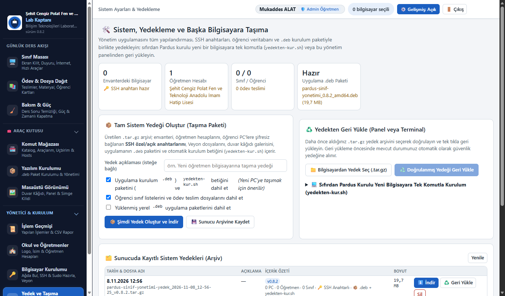

* **Tam Sistem Yedeği (.tar.gz):** Bilgisayar listesini, öğretmen hesaplarını, SSH anahtarlarını, Veyon sertifikalarını, duvar kâğıtlarını ve `.deb` paketini tek bir sıkıştırılmış arşivde toplar.
* **Tek Komutla Kurulum (`yedekten-kur.sh`):** Yeni bir Pardus bilgisayara geçtiğinizde arşiv içindeki `sudo bash yedekten-kur.sh` komutunu çalıştırmanız yeterlidir; sıfırdan kurulum yapılır ve eski bilgisayardaki tüm ayarlar, anahtarlar ve laboratuvar bağlantıları aynen geri yüklenir. Öğrenci bilgisayarlarını yeniden hazırlamanız gerekmez.
