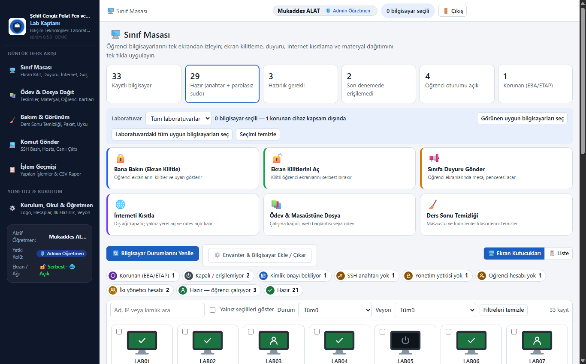
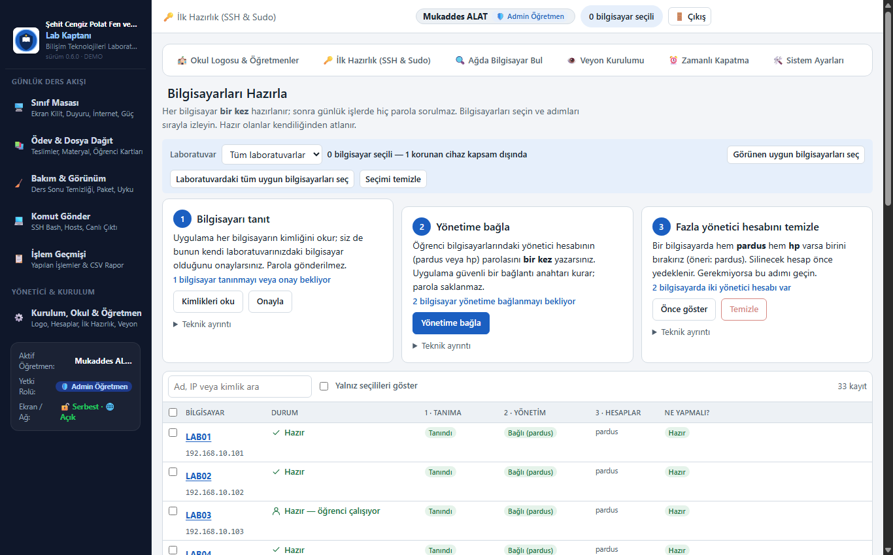
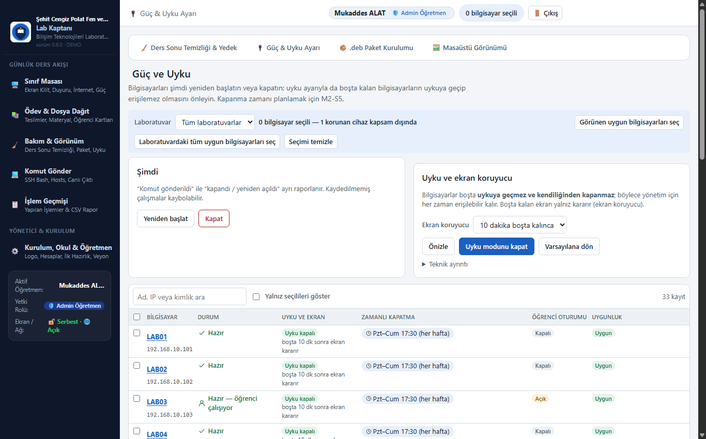
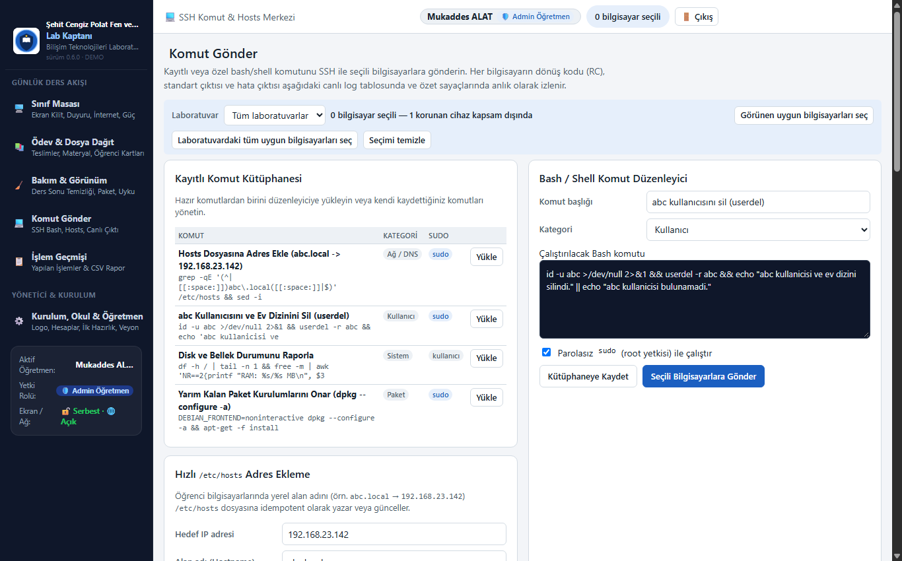
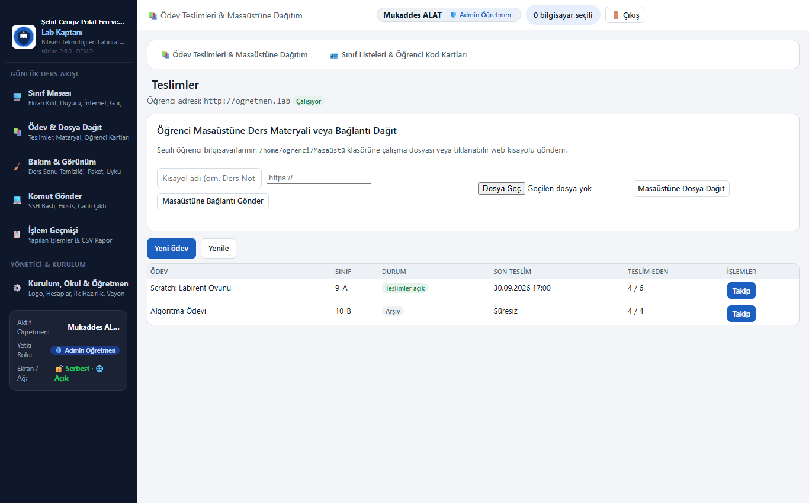
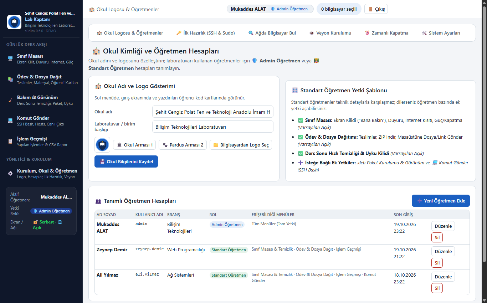

# Lab Kaptanı — Öğretmen Kullanım Kılavuzu

Bu kılavuz, bilgisayar laboratuvarını yöneten öğretmenler için hazırlanmıştır. Lab Kaptanı, karmaşık komutlar veya teknik bilgi gerektirmeden, tüm laboratuvarı tek ekrandan yönetmenizi sağlar.

---

## 1. Kurulum ve İlk Giriş

Lab Kaptanı yalnızca **öğretmen bilgisayarına** tek bir paketle kurulur. Öğrenci bilgisayarlarına hiçbir program yüklenmesi gerekmez.

```bash
sudo dpkg -i pardus-sinif-yonetimi_0.7.0_amd64.deb
```

Kurulum tamamlandığında uygulama arka planda çalışmaya başlar. Masaüstünüzdeki **Lab Kaptanı** simgesine tıklayarak arayüzü açabilirsiniz.

* **İlk Giriş:** Kurulum kodunuz otomatik olarak okunur veya ilk girişte yönetici parolanızı belirlersiniz.
* **Varsayılan Yönetici:** Sistemde tam yetkili yönetici öğretmen tanımlıdır (varsayılan: **Mukaddes ALAT**).
* Giriş parolanız yalnızca bu uygulamaya erişim içindir; öğrenci bilgisayarlarının şifresiyle ilişkisi yoktur.

---

## 2. Sınıf Masası ve Canlı Ders Araçları

Sınıf Masası, ders esnasında en çok kullanacağınız ana kontrol panelidir. Üst panelde laboratuvarın anlık durumu, altında ise tek tıkla sınıfa uygulayabileceğiniz canlı ders araçları yer alır.


### 🔒 Bana Bakın (Ekran Kilitleme)
* Öğrencilerin dikkatini tahtaya veya öğretmene çekmek istediğinizde **Bana Bakın** butonuna tıklayın.
* Seçili tüm öğrenci bilgisayarlarının ekranları kilitlenir, dikkat çekici görsel uyarı görüntülenir ve klavye/fare girişi geçici olarak engellenir.
* İşlem arka planda milisaniyeler içinde gerçekleşir.

### 🔓 Ekran Kilitlerini Aç
* Ders anlatımı bittiğinde veya öğrencilerin uygulamaya geçmesini istediğinizde **Ekran Kilitlerini Aç** butonuna tıklayın.
* Tüm kilitli öğrenci ekranları anında serbest kalır ve öğrenciler çalışmalarına kaldıkları yerden devam eder.

### 📢 Sınıfa Duyuru Gönder
* Sınıfa seslenmek yerine ekranda görünmesini istediğiniz bir mesajı (örneğin: *"Dersin bitmesine 5 dakika kaldı, lütfen projelerinizi kaydedin."*) gönderebilirsiniz.
* Duyuru penceresi öğrenci ekranlarının tam ortasında açılır ve öğrenci onaylayana kadar görünür kalır.

### 🌐 İnterneti Kısıtla / Aç
* Sınav esnasında veya dikkatin dağılmasını önlemek için **İnterneti Kısıtla** butonuna tıklayarak dış dünya internet erişimini tek tıkla engelleyebilirsiniz.
* Bu kısıtlama, yerel laboratuvar ağını ve öğretmenin ödev portalını açık tutar; böylece öğrenciler öğretmen bilgisayarına dosya yüklemeye devam edebilir.
* Tekrar **İnterneti Aç** denildiğinde tüm kısıtlamalar anında kalkar.

### 📚 Ödev & Masaüstüne Dosya
* Öğrencilerin masaüstüne çalışma kağıdı, PDF, görsel veya doğrudan tıklanabilir bir web bağlantısı göndermenizi sağlar.

### 🧹 Ders Sonu Hızlı Temizliği
* Ders bittiğinde seçili bilgisayarların Masaüstü ve İndirilenler klasörlerini temizler; laboratuvarı bir sonraki derse hazır hale getirir.

---

## 3. Bilgisayar Durumları ve Cihaz Detay Özeti

Sınıf Masası'nda her bilgisayar durumunu simgeleyen renkli monitör kutucuklarıyla gösterilir.


### Durum Renkleri ve Anlamları
| Renk / Simge | Durum | Açıklama |
| --- | --- | --- |
| 🟢 **Yeşil ✓** | **Hazır** | Bilgisayar açık, SSH anahtarı ve yönetim yetkisi tam. Tüm işlemlere hazır. |
| 👤 **Yeşil İkon** | **Öğrenci Çalışıyor** | Bilgisayarda öğrenci oturumu açık ve aktif olarak kullanılıyor. |
| ⚫ **Koyu Gri** | **Kapalı / Erişilemiyor** | Bilgisayar kapalı veya ağ bağlantısı yok. |
| 🟠 **Turuncu** | **Hazırlık Gerekli** | Bilgisayar açık fakat henüz yönetim anahtarı veya yetkisi kurulmamış. |
| 🔵 **Mavi** | **Kimlik Onayı Bekliyor** | Bilgisayar ilk kez tespit edildi; güvenli kimlik onayı bekliyor. |
| 🟣 **Mor Kalkan** | **Korunan Cihaz** | EBA / ETAP etkileşimli tahta gibi sisteme dahil edilmeyen cihazlar. |
| 👥 **Sarı** | **İki Yönetici Hesabı** | Bilgisayarda hem `pardus` hem `hp` hesabı var; tekilleştirme önerilir. |

### 🔍 Bilgisayar Detay Özeti (Açılır Pencere)
Herhangi bir bilgisayar kutucuğundaki monitör görseline veya bilgisayar adına tıkladığınızda, o bilgisayara ait özet bilgi penceresi açılır:



Bu pencerede:
* Bilgisayarın IP adresi ve portu,
* Anlık çalışma durumu ve aktif kullanıcı bilgisi,
* Laboratuvar grubu,
* Donanım, boş disk alanı ve RAM bilgisi,
* Kurulu Veyon sürümü ve güç/uyku ayar durumu yer alır.

---

## 4. Bilgisayarları Hazırlama (İlk Kurulum)

Laboratuvara yeni eklenen bilgisayarlar için bu işlem **yalnızca bir kez** yapılır. Hazırlık tamamlandıktan sonra günlük derslerde bir daha asla şifre girmeniz gerekmez.



Hazırlık ekranı üç kolay adımdan oluşur:
1. **1. Bilgisayarı Tanıt:** Bilgisayarların güvenlik kimliklerini okuyun ve onaylayın.
2. **2. Yönetime Bağla:** Öğrenci bilgisayarlarındaki yönetici şifresini (`pardus` veya `hp`) bir kez yazın. Lab Kaptanı güvenli bağlantı anahtarını kurar ve parolasız yönetim yetkisi tanımlar. Şifre sisteme kaydedilmez.
3. **3. Fazla Yönetici Hesabını Temizle:** Bilgisayarda hem `pardus` hem `hp` hesabı varsa, biri yedeklenerek kaldırılır ve hesap yapısı standart hale getirilir.

---

## 5. Bakım, Görünüm ve Güç Yönetimi

**Bakım & Görünüm** menüsü, laboratuvarın genel çalışma düzenini korumanızı sağlar.



* **Uyku Modunu Kapat:** Öğrenci bilgisayarlarının boşta kalınca uykuya geçmesini veya kapanmasını engeller. Bilgisayarlar arka planda açık kalır, sadece ekran kararır (böylece uzaktan erişim asla kesilmez).
* **Zamanlı Kapatma:** Ders bitim saatine (örneğin hafta içi her gün 17:30) otomatik kapanma planı kurabilirsiniz. Kapanmadan önce öğrenci ekranına uyarı bildirimi gönderilir.
* **Masaüstü Görünümü:** Tüm bilgisayarlara standart okul duvar kâğıdı atanabilir ve Windows 10 benzeri tanıdık masaüstü düzeni uygulanabilir.

---

## 6. SSH Komut Merkezi (Komut Gönder)

Laboratuvardaki tüm bilgisayarlara veya seçtiğiniz bilgisayarlara aynı anda sistem komutu gönderebilirsiniz.



* **Kayıtlı Komutlar:** Kütüphanedeki hazır komutları (kullanıcı silme, disk/RAM kontrolü, paket onarımı vb.) tek tıkla yükleyebilirsiniz.
* **Canlı Çıktı:** Komutun her bilgisayardaki çalışma sonucu, başarı durumu ve terminal çıktısı anında ekranda listelenir.
* **Hızlı `/etc/hosts` Ekleme:** Yerel sunucuların veya öğretmen bilgisayarının adını (`ogretmen.lab`) öğrenci bilgisayarlarına tek tıkla kaydedebilirsiniz.

---

## 7. Ödev Dağıtımı ve Teslim Portalı

Öğrenciler ödevlerini internete ihtiyaç duymadan, yerel ağ üzerinden öğretmen bilgisayarına yükleyebilir.



1. **Materyal Dağıtımı:** Öğrencilerin masaüstüne tek tıkla ders notu, örnek kod veya web bağlantısı gönderebilirsiniz.
2. **Ödev Oluşturma:** Başlık, son teslim tarihi ve izinli dosya türlerini belirleyin.
3. **Öğrenci Teslim Kodları:** Öğrenciler kendi adlarına üretilen 8 karakterli kodla `http://ogretmen.lab:8090` adresinden ödevlerini gönderir.
4. **Toplu İndirme (ZIP):** Öğretmen tek tıkla tüm sınıfın ödevlerini öğrenci numarası ve ada göre klasörlenmiş tek bir ZIP arşivi olarak indirebilir.

---

## 8. Okul Kimliği ve Öğretmen Hesapları

**Kurulum, Okul & Öğretmen** ekranından okulunuza özel ayarları yapabilirsiniz:



* **Okul Adı ve Logosu:** Okulunuzun adını yazabilir (varsayılan: *Şehit Cengiz Polat Fen ve Teknoloji Anadolu İmam Hatip Lisesi*) ve bilgisayarınızdan okul armasını yükleyebilirsiniz.
* **Öğretmen Hesapları:** Laboratuvarı paylaşan zümre öğretmenleri için ayrı hesaplar tanımlayabilirsiniz.
* **Yetki Rolleri:**
  * **Admin Öğretmen:** Tüm sistem ayarlarına, paket kurulumuna ve okul ayarlarına tam erişim sahibidir.
  * **Standart Öğretmen:** Yalnızca canlı ders araçlarını, Sınıf Masası'nı ve ödev modülünü kullanır; kritik sistem ayarları gizlenir.
