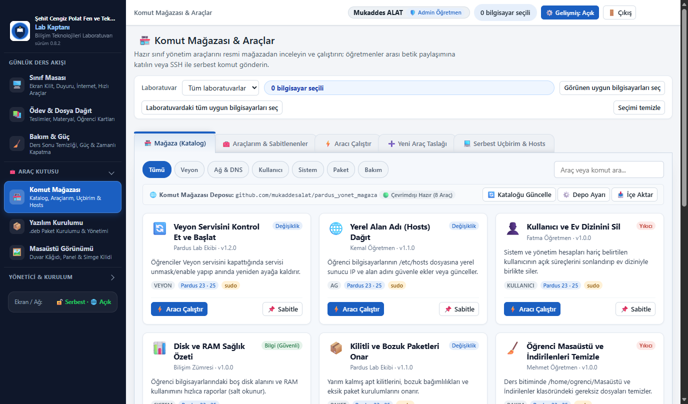
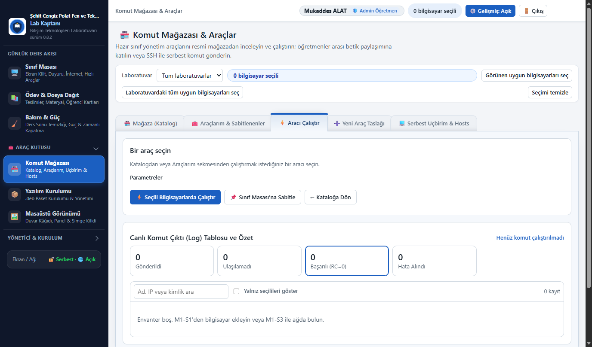
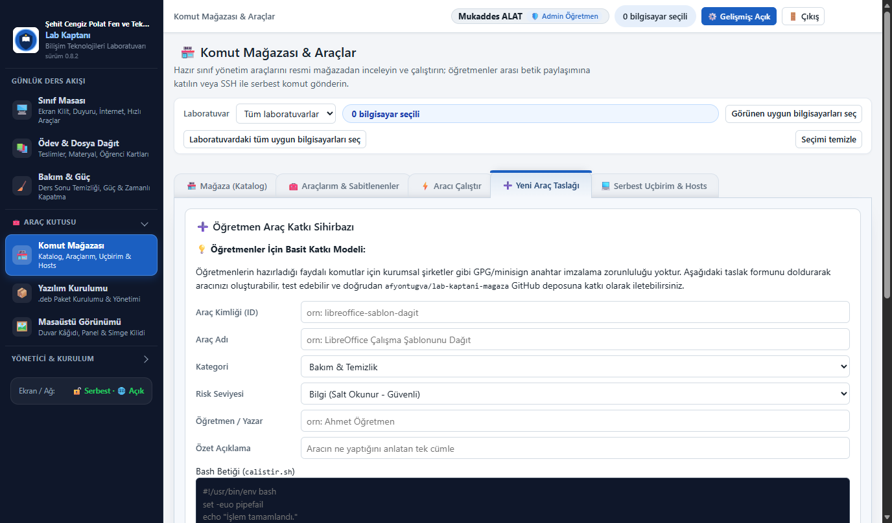
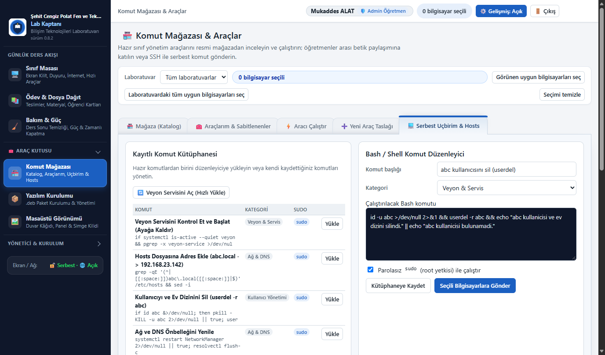
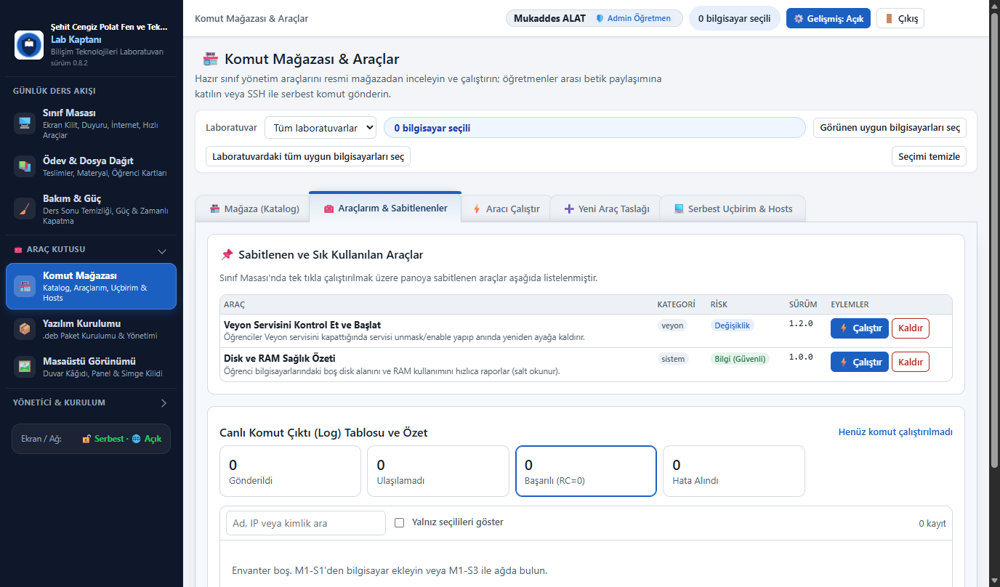

# Lab Kaptanı — Komut Mağazası ve Betik Geliştirme Kılavuzu

Bu belge, **Lab Kaptanı (Pardus Sınıf Yönetimi)** Komut Mağazası mimarisini, resmi GitHub deposunu ve öğretmenlerin sınıfları için nasıl özel araç ve Bash betiği hazırlayacağını adım adım açıklar.



---

## 🌐 Resmi Depo ve Bağlantılar

Lab Kaptanı Komut Mağazası bağımsız, açık kaynaklı bir topluluk deposu olarak GitHub üzerinde barındırılır:

* **Mağaza Web Adresi:** [https://github.com/mukaddesalat/pardus_yonet_magaza](https://github.com/mukaddesalat/pardus_yonet_magaza)
* **Git Klonlama Bağlantısı:** `https://github.com/mukaddesalat/pardus_yonet_magaza.git`
* **Doğrudan Katalog JSON Bağlantısı:** `https://raw.githubusercontent.com/mukaddesalat/pardus_yonet_magaza/main/katalog.json`
* **Öğretmen Bilgisayarındaki Yerel Konum:** `/var/lib/pardus-sinif-yonetimi/magaza/`

> [!NOTE]
> Lab Kaptanı, öğretmen bilgisayarında gereksiz disk alanı ve Git bağımlılığı yaratmamak için depodaki `katalog.json` dosyasını doğrudan HTTP GET ile çeker ve günceller. Öğretmen arayüzdeki **"Kataloğu Güncelle"** butonuna bastığında en güncel araç listesi anında panele yansır.

---

## 🏛️ Mağaza Mimarisi ve Klasör Düzeni

Mağaza deposu modüler bir hiyerarşiye sahiptir. Depodaki her araç, bağımsız bir klasör içinde bir metaveri dosyası (`arac.json`) ve hedef Pardus bilgisayarlarında çalıştırılacak bir Bash betiğinden (`betik.sh`) oluşur:

```text
pardus_yonet_magaza/
├── README.md               # Depo tanıtımı ve katkı rehberi
├── katalog.json            # Tüm araçların toplu indeksi (Lab Kaptanı burayı okur)
└── araclar/                # Araç paketleri dizini
    ├── veyon-servis-ac/
    │   ├── arac.json       # Aracın adı, açıklaması, parametreleri
    │   └── betik.sh        # Çalıştırılacak shell betiği
    ├── hosts-kayit-ekle/
    │   ├── arac.json
    │   └── betik.sh
    └── paket-guncelleme-sayaci/
        ├── arac.json
        └── betik.sh
```

---

## ⚙️ `arac.json` Şeması ve Alanları

Her aracın davranışını, yetki seviyesini ve kullanıcıdan alınacak parametreleri `arac.json` dosyası belirler:

| Alan | Tür | Zorunlu mu? | Açıklama |
| :--- | :--- | :---: | :--- |
| `id` | Metin | Evet | Benzersiz sistem adı (örn. `paket-guncelleme-sayaci`). Yalnızca küçük harf, rakam ve tire içermelidir. |
| `ad` | Metin | Evet | Arayüzde görünecek Türkçe başlık (örn. `Güncellenebilir Paket Sayacı ve Raporu`). |
| `kategori` | Metin | Evet | Aracın türü: `bakim`, `ag`, `paket`, `guvenlik`, `sistem`, `kullanici`, `veyon`. |
| `risk` | Metin | Evet | `bilgi` (sadece veri okur), `degisiklik` (zararsız ayar yapar), `yikici` (dosya siler, kullanıcı kaldırır). |
| `ozet` | Metin | Evet | Kart üzerinde görünecek 1–2 cümlelik açıklama. |
| `yazar` | Metin | Evet | Aracı geliştiren öğretmen veya zümre adı. |
| `surum` | Metin | Evet | Anlamsal sürüm (örn. `1.0.0`). |
| `sudo` | Mantıksal | Evet | `true` ise hedef makinede parolasız `sudo` ile çalışır; `false` ise normal kullanıcı yetkisiyle çalışır. |
| `parametreler` | Dizi | Hayır | Kullanıcıdan arayüzde form ile istenecek dinamik değişkenler. |

### Parametre Türleri (`parametreler`)
* **`metin`**: Serbest metin girişi (örn. IP adresi, dosya yolu).
* **`sayi`**: Sayısal değer (örn. port numarası, bekleme süresi).
* **`onay`**: Evet/Hayır onay kutusu (`true` / `false`).
* **`secim`**: Önceden belirlenmiş liste (`secenekler` dizisi ile tanımlanır).

> [!TIP]
> **Betik İçinde Parametrelere Erişim:**
> Formda tanımladığınız `ad` alanları, betik çalışırken otomatik olarak **`$PSY_P_<parametre_adi>`** ortam değişkeni olarak iletilir. Örneğin parametre adı `detay_goster` ise betik içinde `$PSY_P_detay_goster` olarak okunur.

---

## 🛠️ Uygulamalı Senaryo: "Güncellenebilir Paket Sayacı ve Raporu"

Gelin somut ve faydalı bir senaryo üzerinden sıfırdan çalışan bir araç geliştirelim:
**Senaryo:** *"Sınıftaki tüm bilgisayarlarda kaç tane bekleyen sistem güncellemesi ve güvenlik yaması olduğunu bilgisayar başına hesaplayıp tek tek sayan ve temiz bir rapor sunan araç."*



### Adım 1: `arac.json` Dosyasını Oluşturun

Klasör yolu: `araclar/paket-guncelleme-sayaci/arac.json`

```json
{
  "id": "paket-guncelleme-sayaci",
  "ad": "Güncellenebilir Paket Sayacı ve Raporu",
  "kategori": "bakim",
  "risk": "bilgi",
  "ozet": "Sınıftaki bilgisayarlarda kaç adet güncellenebilir paket ve güvenlik yaması olduğunu bilgisayar başına hesaplayıp temiz bir liste halinde raporlar.",
  "yazar": "Pardus Lab Topluluğu",
  "surum": "1.0.0",
  "sudo": false,
  "parametreler": [
    {
      "ad": "onbellek_guncelle",
      "etiket": "Önce Depo Listesini Güncelle (apt update)",
      "tip": "secim",
      "secenekler": [
        "hayir",
        "evet"
      ],
      "varsayilan": "hayir",
      "zorunlu": true,
      "aciklama": "'evet' seçilirse önce depolardan güncel liste çekilir; 'hayir' seçilirse mevcut önbellek taranır."
    },
    {
      "ad": "detay_goster",
      "etiket": "Rapor Detay Düzeyi",
      "tip": "secim",
      "secenekler": [
        "ayrintili",
        "ozet"
      ],
      "varsayilan": "ayrintili",
      "zorunlu": true,
      "aciklama": "'ayrintili' seçildiğinde güncellenecek paket adları listelenir; 'ozet' seçildiğinde sadece toplam sayılar gösterilir."
    }
  ]
}
```

---

### Adım 2: `betik.sh` Bash Kodunu Yazın

Klasör yolu: `araclar/paket-guncelleme-sayaci/betik.sh`

Bu betik Pardus/Debian paket yönetim sistemini simülasyon modunda (`apt-get -s dist-upgrade`) çalıştırarak sistemi yormadan, hiçbir şeyi değiştirmeden analizi yapar:

```bash
#!/usr/bin/env bash
# ==============================================================================
# Lab Kaptanı — Güncellenebilir Paket Sayacı ve Raporu
# Pardus 21/23 / Debian uyumlu
# ==============================================================================
set -e

# Formdan gelen parametreleri karşıla (varsayılan değerlerle emniyete al)
ONBELLEK="${PSY_P_onbellek_guncelle:-hayir}"
DETAY="${PSY_P_detay_goster:-ayrintili}"

# Bilgisayar kimlik bilgileri
HOSTNAME_VAL=$(hostname 2>/dev/null || cat /etc/hostname 2>/dev/null || echo "Bilinmiyor")
IP_VAL=$(hostname -I 2>/dev/null | awk '{print $1}')

echo "=================================================="
echo "  PARDUS PAKET GÜNCELLEME SAYACI VE ANALİZİ"
echo "  Bilgisayar: $HOSTNAME_VAL ($IP_VAL)"
echo "  Tarih: $(date '+%Y-%m-%d %H:%M:%S')"
echo "=================================================="

# Kullanıcı depoyu güncellemek istediyse apt-get update çalıştır
if [ "$ONBELLEK" = "evet" ]; then
    echo -e "\n[*] Depolar taranıyor (apt-get update)..."
    if [ "$(id -u)" -eq 0 ] || sudo -n true 2>/dev/null; then
        sudo -n apt-get update -qq || echo "[!] Uyarı: apt-get update kısmi hata verdi, devam ediliyor."
    else
        echo "[!] Sudo yetkisi bulunamadı, mevcut önbellek ile devam ediliyor."
    fi
fi

# Paket güncelleme simülasyonunu çalıştır (sistemi değiştirmez, salt okunurdur)
SIM_OUT=$(LC_ALL=C apt-get -s dist-upgrade 2>/dev/null || true)

# Toplam güncellenebilir paket sayısını hesapla
UPG_COUNT=$(echo "$SIM_OUT" | grep -E "^[0-9]+ upgraded" | awk '{print $1}')
[ -z "$UPG_COUNT" ] && UPG_COUNT=0

# Güvenlik güncellemelerini süz
SEC_COUNT=$(echo "$SIM_OUT" | grep "^Inst " | grep -Ei "(security|debian-security|pardus-security|-updates)" | wc -l || echo 0)

# Çekirdek (Linux Kernel) güncellemesi kontrolü
KERNEL_UPG=$(echo "$SIM_OUT" | grep "^Inst linux-image" | wc -l || echo 0)

echo ""
# Lab Kaptanı durum rozeti bildirimi
echo "::psy:bilgi=Güncelleme analizi: $UPG_COUNT paket güncellenebilir."

if [ "$UPG_COUNT" -eq 0 ]; then
    echo "  Durum                          : [GÜNCEL] Sistem günceldir."
    echo "  Toplam Güncellenebilir Paket   : 0"
    echo "  Güvenlik Güncellemesi          : 0"
    echo "=================================================="
    echo "::psy:sonuc=guncel"
    exit 0
fi

echo "  Durum                          : [GÜNCELLEME GEREKLİ]"
echo "  Toplam Güncellenebilir Paket   : $UPG_COUNT adet"
echo "  Güvenlik Güncellemesi          : $SEC_COUNT adet"
if [ "$KERNEL_UPG" -gt 0 ]; then
    echo "  Çekirdek (Kernel) Güncellemesi : VAR ($KERNEL_UPG adet yeni çekirdek)"
else
    echo "  Çekirdek (Kernel) Güncellemesi : Yok"
fi
echo "=================================================="

# Ayrıntılı mod seçildiyse paketleri tek tek listele
if [ "$DETAY" = "ayrintili" ]; then
    echo ""
    echo "Güncellenecek Paketlerin Listesi:"
    echo "--------------------------------------------------"
    echo "$SIM_OUT" | grep "^Inst " | while read -r line; do
        PKG=$(echo "$line" | awk '{print $2}')
        NEW_VER=$(echo "$line" | sed -n 's/.*(\(.*\) .*/\1/p' | awk '{print $1}')
        IS_SEC=$(echo "$line" | grep -Ei "(security|debian-security|-updates)" >/dev/null && echo "[GÜVENLİK]" || echo "")
        printf "  %-32s -> %-20s %s\n" "$PKG" "$NEW_VER" "$IS_SEC"
    done
    echo "--------------------------------------------------"
fi

echo ""
echo "Öneri:"
if [ "$SEC_COUNT" -gt 0 ]; then
    echo "  [DİKKAT] $SEC_COUNT adet kritik güvenlik güncellemesi var! Güncellenmesi tavsiye edilir."
fi
echo "  Toplu güncellemek için: Lab Kaptanı 'Yazılım Merkezi' veya 'Serbest Uçbirim' üzerinden 'sudo apt-get upgrade -y' komutunu verebilirsiniz."
echo "=================================================="
```

---

## 🧪 Adım 3: Betiği Test Etme

Betiğinizi GitHub'a göndermeden önce iki pratik yolla test edebilirsiniz:

1. **Arayüzden Test (Yeni Araç Taslağı Sekmesi):**
   - Lab Kaptanı'nda **Komut Mağazası & Araçlar → Yeni Araç Taslağı** sekmesine geçin.
   - Yazdığınız `arac.json` ve `betik.sh` kodlarını yapıştırın ve **"Taslağı Çalıştır"** butonuna basarak seçtiğiniz bir bilgisayarda canlı çıktısını görün.
   

2. **Serbest Uçbirim ile Hızlı Deneme:**
   - **Komut Mağazası & Araçlar → Serbest Uçbirim** sekmesini açarak betiğin belirli satırlarını tek bilgisayara gönderip anlık çıktıyı inceleyebilirsiniz.
   

---

## 🚀 Adım 4: Mağazaya Katkı Sağlama ve Yayınlama (Git Workflow)

Hazırladığınız aracı tüm Pardus okullarıyla paylaşmak çok kolaydır:

1. [https://github.com/mukaddesalat/pardus_yonet_magaza](https://github.com/mukaddesalat/pardus_yonet_magaza) adresini açın ve sağ üstteki **Fork** düğmesine tıklayın.
2. Bilgisayarınızda repoyu klonlayın:
   ```bash
   git clone https://github.com/<kullanici_adiniz>/pardus_yonet_magaza.git
   cd pardus_yonet_magaza
   ```
3. Yeni araç klasörünüzü ekleyin:
   ```bash
   mkdir -p araclar/paket-guncelleme-sayaci
   # arac.json ve betik.sh dosyalarını bu klasöre yerleştirin
   ```
4. `katalog.json` dosyasını açıp aracınızın özet bilgilerini JSON dizisine ekleyin.
5. Değişiklikleri commit edip gönderin:
   ```bash
   git add .
   git commit -m "feat: paket-guncelleme-sayaci aracı eklendi"
   git push origin main
   ```
6. GitHub üzerinden **New Pull Request** butonuna basın. Depo yöneticisi güvenlik kontrolünü yaptıktan sonra aracı ana depoya dahil eder.

---

## 📲 Adım 5: Lab Kaptanı'nda Güncelleme ve Sınıfta Çalıştırma

Aracınız ana depoda birleştirildiği anda:

1. Öğretmen bilgisayarında Lab Kaptanı'nı açın.
2. **Komut Mağazası & Araçlar → Komut Kataloğu** sekmesine gelin.
3. Sağ üstteki **"Kataloğu Güncelle"** düğmesine tıklayın.
4. Yeni aracınız kart olarak listede belirir.
5. **"Kullan"** veya **"Araçlarıma Ekle"** butonuna basarak aracı seçin, parametrelerini girin ve sınıftaki 30 bilgisayara tek tıkla gönderin!



