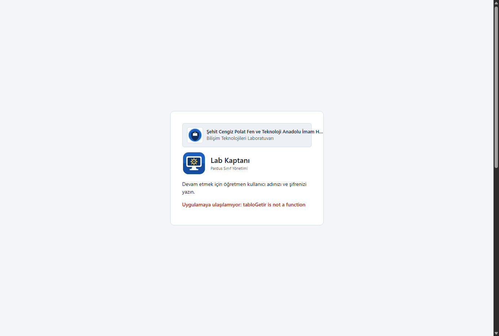
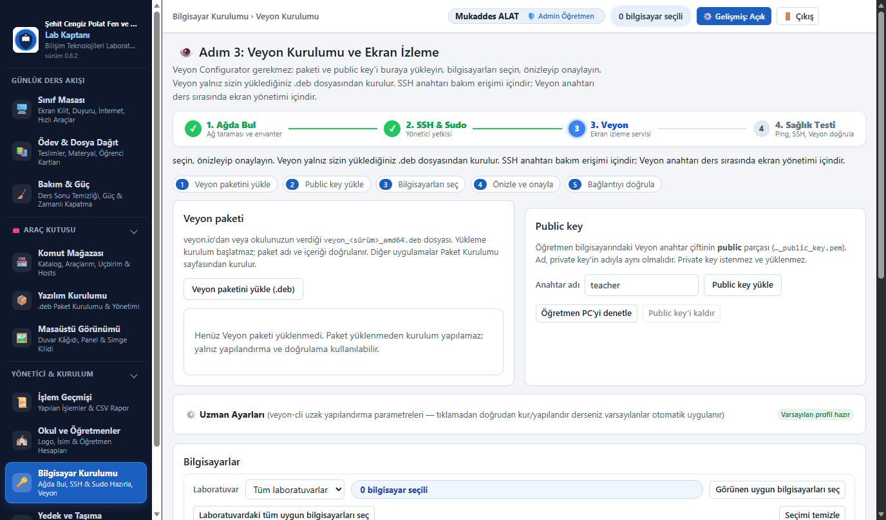
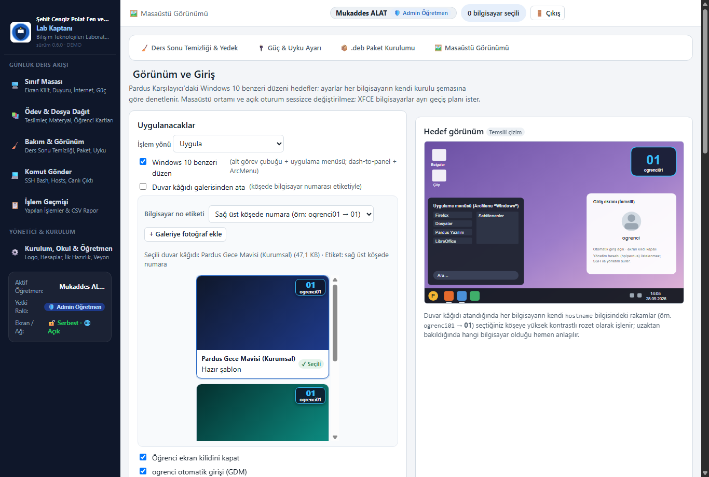
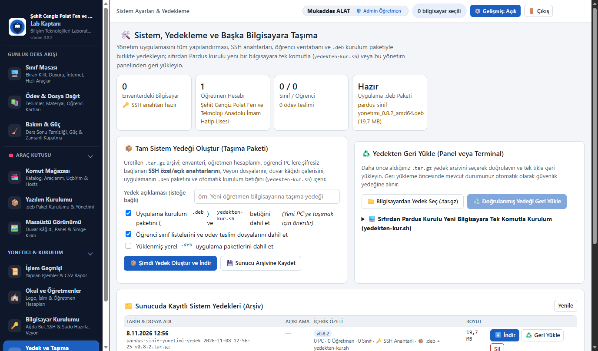

# Lab Kaptanı (Pardus Sınıf Yönetimi) — Yönetici Kılavuzu

Sistem yöneticileri için kurulum, mimari, veri konumları, güvenlik modeli ve kurtarma.
Sürüm 0.8.0.

## Kurulum

Öğretmen bilgisayarında (Pardus 23 EDU) tek komut yeterlidir:

```bash
sudo dpkg -i pardus-sinif-yonetimi_0.8.0_amd64.deb
```

Paket kendi Python çalışma ortamını ve tüm kütüphaneleri içerir; kurulum
sırasında internetten hiçbir şey indirilmez ve sistemdeki Python sürümüne
bağlı değildir. Bağımlılıkları (`libc6 >= 2.28`, `systemd`, `passwd`) her
Pardus kurulumunda zaten vardır. Kurulum sonunda terminalde ilk kurulum kodu
gösterilir; masaüstü simgesi ilk açılışta bu kodu yönetici parolasıyla
kendiliğinden doldurur.

Kurulum şunları yapar:

1. `pardus-sinif` adlı ayrıcalıksız sistem kullanıcısını oluşturur (giriş kabuğu yok).
2. `/var/lib/pardus-sinif-yonetimi/` veri dizinini hazırlar (0700, yalnızca servis kullanıcısı).
3. 8080–8090 arasında boş bir yerel port seçer (`/etc/pardus-sinif-yonetimi/ortam`).
4. `pardus-sinif-yonetimi.service` ve öğrenci ödev portalı `pardus-sinif-odev.service`
   sistem servislerini etkinleştirip başlatır.
5. Uygulama menüsüne ve paketi kuran kullanıcının masaüstüne simge ekler.

Arayüzün örnek verili, sunucusuz önizlemesi pakette de vardır:
`/usr/share/doc/pardus-sinif-yonetimi/arayuz-onizleme.html` (çift tıklayarak açılır).

## Mimari

- **Öğretmen PC:** `/opt/pardus-sinif-yonetimi/` altında gömülü Python 3.12 ve
  uygulama. Servis `pardus-sinif` kullanıcısıyla çalışır, yalnızca `127.0.0.1`
  üzerinde dinler ve systemd sertleştirmesiyle yalnızca kendi veri dizinine
  yazabilir. Arayüz tarayıcıdan kullanılır.
- **Öğrenci PC:** Ajan yoktur. Yönetim, bilgisayardaki **tek** yönetim hesabına
  (`pardus` veya `hp`) eklenen uygulamaya özel Ed25519 anahtarıyla SSH üzerinden
  yapılır. İşlemler hedefteki Python 3 ile çalışan sabit izin listeli uzak
  betiklerdir (`uygulama/uzak/`: durum, hazırlık, hesap, görünüm, paket, temizlik,
  yedek); serbest komut girişi yoktur (karar 12).
- **Ansible:** Laboratuvar Ansible ile de yönetilebilir. **M1-S1-B5** parolasız
  Ansible envanteri indirir: yalnız hazır (anahtar + parolasız sudo) bilgisayarlar,
  laboratuvara göre gruplu, korunan (EBA/ETAP) cihazlar hariç;
  `ansible_user` her bilgisayardaki tekilleştirilmiş yönetim hesabıdır,
  `ansible_become=true`. Uygulama anahtarı Ansible için `--private-key` ile
  kullanılabilir (bkz. Güvenlik modeli).

## Veri konumları

| Konum | İçerik |
| --- | --- |
| Öğretmen: `/var/lib/pardus-sinif-yonetimi/` | `envanter.db` (SQLite), `anahtar/uygulama_ed25519(.pub)`, `duvar_kagidi/galeri/` (duvar kâğıdı görselleri ve `galeri.json`), `paketler/<sha256>.deb` (öğretmenin yüklediği paketler) |
| Öğretmen: `/etc/pardus-sinif-yonetimi/ortam` | Seçilen yerel port (`PSY_PORT`) ve portal ayarları |
| Öğrenci: `/var/lib/pardus-sinif-yonetimi/yedek/` | Profil yedekleri: `ogrenci-<tarih>.tar.gz` + `.sha256` (root, 0700) |
| Öğrenci: `/var/lib/pardus-sinif-yonetimi/karantina/` | Ders sonu temizliğinde taşınan dosyalar: `<tarih>-ogrenci/manifest.json` + `veri/` |
| Öğrenci: `/var/lib/pardus-sinif-yonetimi/hesap-yedekleri/` | Tekilleştirmede silinen yönetim hesabının ev dizini (`hp-<tarih>.tar.gz`) ve hesap satırları (`.json`) |
| Öğrenci: `/var/lib/pardus-sinif-yonetimi/ayar-yedekleri/` | Değiştirilen sistem dosyalarının ilk hâli (ör. `daemon.conf.ilk`) |
| Öğrenci: `/var/cache/pardus-sinif-yonetimi/` | Kurulum için aktarılan `.deb` (başarılı kurulumdan sonra silinir) |
| Öğrenci: `/etc/sudoers.d/pardus-sinif-yonetimi` | Yönetim hesabına parolasız sudo (0440) |
| Öğrenci: `/etc/ssh/sshd_config.d/pardus-sinif-yonetimi.conf` | Yalnız sshd'de AllowUsers/AllowGroups kısıtı varsa: yönetim hesabının izni |
| Öğrenci: `/etc/dconf/db/local.d/91-…duvar`, `92-…gorunum`, `93-…ekran-kilidi` (+ `locks/`) | Duvar kâğıdı (köşede hostname numarası işlenmiş), Windows 10 benzeri düzen, ekran kilidi |
| Öğrenci: `/etc/X11/xorg.conf.d/90-pardus-sinif-dpms.conf` | Donanımsal DPMS monitör kapanmasını engelleme yapılandırması |
| Öğrenci: `/etc/xdg/autostart/pardus-sinif-dpms.desktop` | Açık/yeni oturumlarda ekran kararmasını engelleyen `xset` başlatıcısı |
| Öğrenci: `/var/lib/AccountsService/users/<hesap>` | Yönetim hesabını giriş ekranında gizleme (`SystemAccount=true`) |
| Öğrenci: `/etc/gdm3/daemon.conf` | `ogrenci` otomatik girişi (`[daemon]` bölümü) |

**Öğrenci verisi öğretmen bilgisayarına taşınmaz (karar 18):** yedekler öğrenci
bilgisayarında kalır; yedek listesi her seferinde canlı okunur. Ödev teslim arşivi
(`/var/lib/pardus-sinif-odev/`) öğretmen bilgisayarındadır ve temizlik/sıfırlama
işlemlerine hiçbir zaman dahil edilmez; öğretmen bilgisayarının kendi adresleri
envantere eklenemez.

## Envanter (M1-S1)

Bilgisayar kayıtlarının tek yönetim noktasıdır. Başka menülerde ayrı liste yoktur.

- **Ekleme ve içe aktarma bağlantı kurmaz:** elle ekleme (B1) ve dosyadan içe aktarma
  (B2: Ansible INI envanteri veya `ad;ip;hesap;laboratuvar` CSV) yalnız kayıt
  oluşturur; hesap değiştirmez, paket kurmaz. İçe aktarma önce önizlenir.
- Her satırda ayrı ayrı: ad/IP/Pardus sürümü, masaüstü ve giriş yöneticisi,
  yönetim hesabı, SSH anahtarı, parolasız sudo, `ogrenci` hesabı, öğrenci oturumu,
  yönetim hesabının giriş ekranında gizli olup olmadığı, son kontrol ve **gereken işlem**.
- **Durumu kontrol et** (B3) salt okunurdur; parolasız sudo varsa root olarak, yoksa
  bağlantı hesabının yetkisiyle kısmi okur (ölçülemeyen alanlar “?” kalır).
- **Korunan cihaz (EBA/ETAP):** düzenle penceresinden işaretlenir; durum kontrolünde
  `/etc/os-release` veya kurulu paketlerde ETAP izi bulunursa kendiliğinden
  işaretlenir. Korunan cihaz seçilemez ve hiçbir işleme girmez; yalnız listeden
  çıkarılabilir.
- **Hostname ve IP Odaklı Cihaz Özeti:** Ekran kutucuğundaki monitör simgesine veya ada
  tıklandığında açılan özet pencerede SSH portu yerine doğrudan **Hostname** ve **IP adresi**
  gösterilir.
- **Canlı Hostname Değiştirme (B7):** Düzenleme penceresinden bilgisayarın adı (hostname)
  değiştirilebilir; Lab Kaptanı parolasız sudo yetkisiyle `hostnamectl set-hostname <yeni_ad>`
  komutunu çalıştırarak uzak bilgisayar adını anında günceller.
- Yönetim hesabı değiştirilirse anahtar yeni hesapta olmadığından bilgisayar
  “Hazırlık gerekli” olur. IP düzenlenemez; farklı adres yeni kayıttır.
- Çıkarırken isteğe bağlı olarak uygulama anahtarı da kaldırılır (yalnız uygulamanın
  satırı). Parolasız sudo dosyası bu işlemle kaldırılmaz (bkz. Geri alma).

### Ekran görünümü ve durum renkleri

M1-S1 varsayılan olarak bilgisayarları Veyon'daki gibi **ekran kutucukları** olarak gösterir
(**B18 Ekranlar** / **B19 Tablo**). Ekranın rengi ve ortasındaki simge tek bir öncelikli
durumu anlatır; üstteki renk açıklaması (**B20**) tıklanınca yalnız o durumdakileri süzer:

| Ekran | Durum | Ne yapılır |
| --- | --- | --- |
| Mor, kalkan | Korunan (EBA/ETAP) | Hiçbir işleme girmez |
| Karanlık, güç simgesi | Kapalı / erişilemiyor | Bilgisayarı açın; ağ kablosunu denetleyin |
| Gri, soru | Henüz tanınmadı | M1-S2 adım 1 |
| Mavi, kimlik kartı | Kimlik onayı bekliyor | M1-S2 adım 1 |
| Turuncu, anahtar | SSH anahtarı yok | M1-S2 adım 2 |
| Turuncu, kilit | Yönetim yetkisi yok | M1-S2 adım 2 |
| Turuncu, kişi ✕ | Öğrenci hesabı yok | M1-S2 adım 2 |
| Koyu sarı, kişiler | İki yönetici hesabı | M1-S2 adım 3 |
| Yeşil, kişi | Hazır — öğrenci çalışıyor | Oturum açık; temizlik/sıfırlama öncesi dikkat |
| Soluk yeşil, soru | Hazır — durum okunmadı | M1-S1-B3 Durumu kontrol et |
| Yeşil, onay | Hazır | — |

Kutucuğun altındaki rozetler: Veyon sürümü, uyku durumu (ay simgesi) ve zamanlı kapatma
plan sayısı (saat simgesi). Kutucuğa tıklamak bilgisayarı seçer; korunan cihaz seçilemez.

### Toplu seçim

Seçim sayfalar arasında korunur. Her işlem sayfasındaki seçim çubuğu (M0-S2):
“Görünen uygun bilgisayarları seç” (yalnız tablonun görünen sayfası), “Laboratuvardaki
tüm uygun bilgisayarları seç” (sayfalama ve aramadan bağımsız), “Seçimi temizle”.
Tablo başlığındaki kutu yalnız görünen satırları seçer. Özet satırı:
“32 bilgisayar seçili — 2 erişilemiyor — 1 korunan cihaz kapsam dışında”;
filtre dışında kalan seçililer ayrıca yazılır, filtre değiştirmek seçimi değiştirmez.
Her işte onay penceresi (M0-S3) sunucudan kesin hedef listesini ve kapsam dışı
kalanları nedenleriyle gösterir; iş başladığında hedef listesi iş kaydına yazılır,
sonradan değişen seçim çalışan işi etkilemez.

## Bilgisayarları hazırla (M1-S2) — SSH anahtarı ve parolasız sudo

Arayüzde sade üç adım olarak görünür: **1 Bilgisayarı tanıt** (kimlik oku/onayla), **2 Yönetime bağla**
(parola bir kez), **3 Fazla yönetici hesabını temizle**. Teknik ayrıntılar her adımın “Teknik ayrıntı”
bölümündedir; işlevler ve kodlar (B1–B9) değişmedi.

Hazırlık bilgisayar başına **bir kez** yapılır; sonrasında günlük işlerde (temizlik,
yedek, paket, görünüm, güç…) SSH veya sudo parolası sorulmaz.

1. **Sunucu kimliği** okunur (B1, parola gönderilmez) ve öğretmen parmak izini
   onaylar (B2). Onaysız bilgisayara hiçbir kimlik bilgisi gitmez.
2. **Hazırlığı başlat** (B3): öğretmen `pardus` ve/veya `hp` hesabının öğrenci
   bilgisayarındaki parolasını bir kez girer. Parola yalnız işin belleğinde durur;
   veritabanına, iş kaydına ve loglara yazılmaz. Hesap+bilgisayar başına en çok 3
   yanlış deneme yapılır (kalıcı bütçe). Sudo yapabilen hesap seçilir (önce pardus).
3. Uygulama anahtarı `~/.ssh/authorized_keys` dosyasına eklenir.
4. **Parolasız sudo:** `/etc/sudoers.d/pardus-sinif-yonetimi` dosyası önce sudo'nun
   okumadığı geçici adla yazılır, `visudo -cf` ile doğrulanır, sonra yerine taşınır ve
   tüm yapılandırma `visudo -c` ile yeniden denetlenir; hata olursa eski hâline döner.
5. sshd'de AllowUsers/AllowGroups kısıtı varsa yönetim hesabına izin eklenir
   (`sshd -t` ile doğrulanır). DenyUsers engeli kendiliğinden kaldırılmaz.
6. İstenirse `ogrenci` hesabı oluşturulur: sudo/adm grubuna **konmaz**, parolası boştur
   (giriş ekranından parolasız girilir; sshd varsayılanı boş parolayı reddettiği için
   ağdan girilemez).
7. **Doğrulama:** YENİ ve bağımsız bir SSH oturumunda yalnız anahtarla bağlanılır;
   `whoami` ve `sudo -n true` başarılı olmadan bilgisayar “hazır” sayılmaz.

Günlük işlerde uzak komutlar `sudo -n` ile çalışır. Parolasız sudo yoksa iş açık
hata verir (“Parolasız sudo hazır değil — M1-S2”); parola döngüsü yoktur.
Uygulamanın giriş parolası ile öğrenci bilgisayarlarının sudo parolası ayrı şeylerdir.

> **UYARI — root eşdeğeri yetki:** Bu uygulama ve genel Ansible yönetimi uzak
> bilgisayarda serbest komut (`python3 -c …`, Ansible modülleri) çalıştırdığı için
> komut listesiyle sınırlanmış sudo işe yaramaz; yönetim hesabına
> `NOPASSWD: ALL` verilir. Bu, **yönetim hesabına ve onun SSH anahtarına sahip
> olan herkese o bilgisayarda root yetkisi** demektir. Uygulama anahtarı
> (`/var/lib/pardus-sinif-yonetimi/anahtar/uygulama_ed25519`) parolasızdır;
> öğretmen bilgisayarını disk şifreleme, ekran kilidi ve güçlü parolayla koruyun,
> anahtarı kopyalamayın. `ogrenci` hesabına sudo verilmez; root SSH girişi açılmaz.

### Yerel hazırlık (hiç yönetim hesabı yoksa)

Bilgisayarda ne `pardus` ne `hp` varsa uygulama kullanıcı/parola denemesine başlamaz;
“Yetkili hesap hazırlığı gerekiyor” der. Bilgisayar başında bir kez (yerel yönetici ile):

```bash
sudo adduser pardus && sudo usermod -aG sudo pardus
sudo apt install openssh-server && sudo systemctl enable --now ssh
```

Ardından M1-S2'de sunucu kimliğini okuyup onaylayın ve hazırlığı başlatın.

### hp / pardus tekilleştirme

Her bilgisayarda `hp` veya `pardus`'tan yalnız biri kalır (karar 21). Yalnız biri
varsa ona dokunulmaz; ikisi varsa öğretmen korunacak olanı seçer (öneri: pardus).
`ogrenci`, `root` ve sistem hesapları kapsam dışıdır.

1. **Önizle** (B4): her iki hesabın ev dizini boyutu, yetkili anahtar sayısı, sudo
   yetkisi, cron işi ve açık oturumları gösterilir.
2. **Uygula** (B5): korunacak hesaba anahtar ve parolasız sudo kurulur, SSH izni
   denetlenir; **yeni oturumda yalnız anahtarla** bağlanıp `sudo -n true`
   doğrulanmadan diğer hesap silinmez. Envanter (ve Ansible envanteri) korunacak
   hesaba geçer.
3. Silinecek hesabın ev dizini ve passwd/shadow/group satırları öğrenci PC'de
   `hesap-yedekleri/` altına yedeklenir ve okunarak doğrulanır; sonra süreçleri
   sonlandırılıp `userdel -r` ile silinir, sudoers ve sshd satırı temizlenir.
4. Uygulamanın o anki bağlantısı silinecek hesapla kurulmuşsa silme, korunacak
   hesabın oturumundan yapılır; kendi oturumundan hesap silinmez. Silinecek hesapta
   (uygulamanınki dışında) açık oturum varsa o bilgisayar atlanır.

## Profil temizliği (M2-S1)

Üç kapsam vardır:

| Kapsam | Ne olur | Yedek |
| --- | --- | --- |
| Ders sonu temizliği | Seçilen alanlar (Masaüstü, İndirilenler, Çöp, Belgeler, Resimler, Müzik, Videolar, tarayıcı, son dosyalar) **karantinaya taşınır** | Karantina (öğrenci PC, geri alınabilir) |
| Profil ayarlarını sıfırla | Ev dizinindeki gizli girdiler silinir — **tarayıcı verileri dahil**; Belgeler ve görünür klasörler korunur | Önce tam profil yedeği (öğrenci PC), doğrulanır |
| Ev dizininin tamamını sıfırla | Ev dizininin **tamamı** silinir — **Belgeler, Masaüstü ve tarayıcı verileri dahil** | Önce tam profil yedeği (öğrenci PC), doğrulanır |

Sıfırlamadan sonra `/etc/skel` içeriği öğrencinin sahipliğinde yeniden konur.
Yedek başarısız veya doğrulanamazsa o bilgisayarda silme başlamaz. Öğrenci oturumu
açıksa sıfırlama başlamaz; öğretmen satırdaki **B4** ile tek bilgisayarın veya
**B5** ile seçili bilgisayarların tümünün oturumunu (onayla) kapatabilir ya da
sıfırlama onayında “oturumu kapatıp devam et”i seçer. Oturum/süreçler ve kullanıcı
bağlamaları sonlanmadan silme yapılmaz.

**Önizleme ve alan hesabı (karar 26):** her bilgisayar için tek satır: hedef hesap,
oturum, kapsam, tahmini açılacak alan, yedek durumu, uygunluk/bekleme nedeni. Özet
kartları: seçili, işleme uygun, öğrenci bilgisayarlarında tahmini açılacak toplam
alan, öğretmen PC'de gereken yedek alanı (0 — yedekler öğrenci PC'de) ve öğretmen
PC'nin boş alanı. Hesap kuralları:

- Mantıksal boyut (st_size) ile diskte kapladığı alan (st_blocks) ayrı ölçülür;
  seyrek dosyalar ve blok yuvarlaması bu yüzden farklı çıkar.
- Aynı dosya (inode) iç içe klasörlerde veya sabit bağlantıyla iki kez sayılmaz;
  başka bir adı ölçülen kümenin dışında olan dosya “serbest kalabilir” sayılmaz.
- Karantina ev dizini ile aynı dosya sistemindeyse taşıma yer açmaz; yer, saklama
  sınırını aşan eski karantina budandığında açılır ve tahmin buna göre verilir.
- Sıfırlamada yedek arşivinin sıkıştırılmış boyutu önceden bilinemez; açılacak alan
  alt–üst sınır aralığı olarak gösterilir.
- Ölçülemeyen bilgisayar toplamda 0 sayılmaz, “ölçülemedi” yazılır. İşlemden sonra
  disk boş alanı ölçülebildiyse “gerçekleşen kazanç (ölçüldü)” gösterilir.

### Yedekten dönüş

**M2-S1-B10** seçilen bilgisayardaki profil yedeklerini ve temizlik karantinasını
canlı listeler; öğretmen birini seçip tamamına geri döner.

- Profil yedeğinde önce `.sha256` doğrulanır; doğrulanamayan yedek geri yüklenmez.
- Kural: dosya yoksa geri konur; aynı adlı dosyanın SHA-256 özeti aynıysa üzerine
  yazılır; farklıysa ikisi de tutulur ve geri gelen `ad (yedek 26.09.2026 14.30).uzantı`
  adını alır. Hiçbir dosya silinmez.
- Yazma, root süreci arşivi açtıktan sonra öğrencinin kendi yetkisine düşürülmüş bir
  alt süreçte yapılır; sembolik bağlantılar, mutlak yollar ve `..` atlanır.
- Saklama sınırı (varsayılan 5, **M5-S1**) profil yedekleri ve karantina için ayrı
  uygulanır; yerel yedek o bilgisayarın disk arızasına karşı koruma sağlamaz.

## Yerel .deb Dağıtımı ve Pardus Yazılım Merkezi (M2-S2)

M2-S2 menüsü iki ana yetenek sunar: öğretmenin yüklediği yerel `.deb` paketlerinin dağıtımı ve
hedef bilgisayarların tanımlı APT depolarından uygulama arama/kurma/kaldırma.

### 1. Yerel .deb Dağıtımı

Öğretmenin yüklediği `.deb` dosyasına özel yetkidir (karar 24); öğrenci ödev
portalına yüklenen dosyalar bu akışa giremez (paketler yalnız yönetim arayüzünden
yüklenir, API dosya yolu kabul etmez, portal servisi yönetim verisine erişemez).

1. **Yükleme:** dosya uzantıya bakılmadan doğrulanır: `ar` imzası, `debian-binary`
   = 2.0, `control.tar.*` ve `data.tar.*` üyeleri, paket adı/sürüm/mimari biçimi
   (zstd gibi desteklenmeyen sıkıştırmada `dpkg-deb`). SHA-256 hesaplanır.
2. **Plan** (B2, hiçbir şey kurulmaz): paket her hedefe yönetim hesabının özel geçici
   klasörüne aktarılır, root'a ait önbelleğe kopyalanırken SHA-256 yeniden doğrulanır.
   Denetimler: Pardus mı, mimari uyumu, `/var/cache/apt/archives` ve `/usr` boş alanı,
   dpkg/apt kilitleri, kurulu sürüm (`dpkg --compare-versions`), `apt-get -s`
   benzetimi (kurulacak / güncellenecek / **kaldırılacak** / sürümü düşecek paketler),
   depodan indirilecek bağımlılıklar ve deponun erişilebilirliği.
3. **Engeller:** paket kaldırma, sürüm düşürme, çözülemeyen bağımlılık, erişilemeyen
   depodan inmesi gereken bağımlılık, kilitli paket yöneticisi, yetersiz alan. Aynı
   sürüm kuruluysa yeniden kurulmaz (“atlanacak”).
4. **Kur** (B3): yalnız onaylanan planda “kurulacak/güncellenecek” çıkan
   bilgisayarlar; denetimler kurulumdan hemen önce yinelenir.
   `apt-get install -y --no-remove -o Dpkg::Options::=--force-confold` kullanılır
   (`--allow-downgrades` verilmez); kurulu sürüm `dpkg-query` ile doğrulanır.
   Sonuç bilgisayar bazında iş kaydındadır.

Paketin kurulum betikleri root yetkisiyle çalışır: yalnız güvenilen paketleri kurun.

### 2. Pardus Yazılım Merkezi ve APT Depo Yönetimi

Yöneticiler veya yetkili öğretmenler, öğrenci bilgisayarlarına doğrudan tanımlı APT
depolarından (Pardus / Debian resmi depoları) paket kurabilir veya kaldırabilir:



- **Katalog ve Depoda Arama (B8):** Sistemde popüler eğitim, kodlama, robotik, ofis ve tasarım
  uygulamaları (Thonny, Arduino, Blender, Inkscape, GIMP, Krita, LibreOffice vb.) kategorize
  kartlar halinde listelenir. Arama çubuğu ile hedef bilgisayardaki APT önbelleğinde (`apt-cache search`)
  canlı sorgu yapılır.
- **Toplu Depo Kurulumu (B9):** Sepete eklenen paketler seçili tek veya çoklu bilgisayara
  `apt-get install -y --no-remove` komutuyla arka planda kurulur ve doğrulanır.
- **Kurulu Uygulamalar ve Güvenli Kaldırma (B10 / B11):** Hedefte kurulu uygulamalar
  listelenir. Kritik masaüstü ve sistem bileşenleri (`gdm3`, `gnome-shell`, `network-manager`,
  `openssh-server`, `sudo`, `pardus-software`, `pardus-welcome`, `veyon`) **korumalı** olarak
  işaretlenir ve kazara kaldırılması engellenir. Kullanıcının kurduğu diğer paketler
  seçilerek güvenle kaldırılabilir (`apt-get remove -y`).

## Veyon kurulum ve yapılandırma (M1-S4)

Öğretmen Veyon Configurator kullanmadan Veyon'u öğrenci bilgisayarlarına kurar ve
anahtar dosyasıyla yapılandırır. Sayfanın dört bölümü vardır: **Veyon paketi**,
**Public key**, **Bilgisayarlar** ve **İşlem sonuçları**. Bu alan M2-S2 genel paket
listesinden ayrıdır: M2-S2'ye Veyon paketi yüklenmez (yüklenirse M1-S4'e yönlendiren
hata verir) ve iki sayfanın paket seçimi birbirini etkilemez.

- **Paket kaynağı:** yalnız öğretmenin **M1-S4-B1** ile yüklediği `.deb`. Paket deposundan
  Veyon kurulmaz (eksik bağımlılıklar her zamanki gibi apt ile çözülür). Paket control
  dosyasından doğrulanır: `Package: veyon` olmalı ve `veyon-service` sağlamalıdır; dosya
  adında “veyon” geçmesi yetmez. Debian'ın parçalı `veyon-service` vb. paketleri tek
  başına kabul edilmez. Yükleme kurulum başlatmaz; birden çok paket varsa uygulanacak
  olan **M1-S4-B2** ile açıkça seçilir. Paketler öğretmen PC'de saklanır.
- **Sürüm kuralı:** kurulu sürüm hedefin kendisinden (`dpkg-query`, dağıtım revizyonu
  dahil, ör. `4.7.5+repack1-1`) okunur ve dpkg kurallarıyla karşılaştırılır. Aynı sürüm
  yeniden kurulmaz; yüklenen paket daha yeniyse güncellenir; hedefte daha yeni sürüm
  varsa **düşürme yapılmaz**, kurulum atlanır ve yapılandırma sürer. Pardus EDU'da hazır
  gelen parçalı Debian paketleri (`veyon-service`, `veyon-master`, `veyon-plugins`,
  `veyon-configurator`, `libveyon-core`) önizlemede açıkça gösterilerek tek pakete
  geçer; Veyon ailesi dışındaki her kaldırma planı engeller.
- **Public key (M1-S4-B4):** yalnız RSA public key (PEM `BEGIN PUBLIC KEY` / `BEGIN RSA
  PUBLIC KEY`) kabul edilir. Private key, SSH anahtarı (`ssh-ed25519 …`) ve geçersiz
  dosyalar içerikten reddedilir; private key hiçbir zaman saklanmaz, aktarılmaz,
  günlüğe yazılmaz. Anahtar adı (**M1-S4-B5**) öğretmen PC'deki private key'in adıyla
  aynı olmalıdır (Veyon yalnız harf/rakam kabul eder). Aynı adla farklı anahtar
  yüklenirse eskisi yedeklenir ve açık onay istenir (**M1-S4-B19**). Arayüzdeki
  “Veyon çift kimliği”, `veyon-cli authkeys list details` çıktısındaki PAIR ID ile
  aynıdır.
- **Öğretmen PC denetimi (M1-S4-B7):** salt okunur. `/etc/veyon/keys/private/<ad>/key`
  dosyasının yalnız varlığı ve izinleri (stat) denetlenir, içeriği okunmaz; aynı adlı
  yerel public key ile eşleşme, öğretmen PC'deki kimlik doğrulama yöntemi ve Veyon
  Master'ı çalıştıran hesabın anahtarı okuyup okuyamadığı gösterilir. Uygulama yeni
  anahtar üretmez. Gereken düzeltmeler komut olarak verilir, ör.
  `sudo veyon-cli authkeys setaccessgroup teacher/private <öğretmen-hesabı>` ve
  `sudo veyon-cli config set Authentication/Method 1`.
- **Akış:** bilgisayarları seç → **B8 Hazırlığı kontrol et** (salt okunur) veya doğrudan
  **B9 Kur/güncelle**, **B10 Yapılandır**, **B11 Kur ve yapılandır**. Her biri önce
  önizleme işi çalıştırır (paket aktarılıp SHA-256 doğrulanır; Pardus sürümü, mimari,
  boş alan, dpkg kilidi ve bağımlılıklar denetlenir; ayar farkı çıkarılır) ve
  hedefleri, mevcut sürümü, kurulacak sürümü ve uygulanacak ayarları gösterir. Onaydan
  sonra her bilgisayarda önce kurulum, başarılıysa yapılandırma yapılır; kurulum
  başarısız veya yarım kalırsa o bilgisayarda yapılandırmaya geçilmez, diğerlerinin
  sonuçları korunur. Öğretmen PC hiçbir zaman hedef olmaz.
- **Sıfırdan Tek Tıkla Standart Yapılandırma:** Paket ve public key yüklüyse, öğretmen
  ek soru yanıtlamak zorunda kalmadan "Kur ve yapılandır" dediğinde aşağıdaki kurumsal
  standartlar uzaktan otomatik uygulanır:
  * **Kimlik Yöntemi:** Anahtar dosya yetkilendirmesi (`Authentication/Method = 1`).
  * **Yetkilendirme Erişim Grubu:** `root` (`veyon-cli authkeys setaccessgroup <ad>/public root` + `chgrp root`).
  * **Kullanıcı Grupları:** Varsayılan POSIX sistem grupları (`Core/UserGroupsBackend = {4f7d98f0-395a-4f32-9096-188c1e7e982b}`, `AccessControl/ProcessUserGroups = false`).
  * **VNC Sunucusu:** Dahili VNC sunucusu (`VncServer/Plugin = {39d7a07f-9467-4927-b68c-4b33880d22d8}`).
  * **Görüntü Kalitesi:** Yüksek kalite (`BuiltinVncServer/Quality = 0`, `VncServer/ImageQuality = 2`).
  * **Port:** 11100.
- **Uzman Ayarları Paneli (M1-S4-B21 / B22):** İleri düzey sistem yöneticileri için
  katlanabilir bir panel olarak tasarlanmıştır. Varsayılan olarak kapalıdır; tıklandığında
  yukarıdaki parametreler placeholder ve seçili değerleriyle incelenebilir veya
  özelleştirilebilir. **B22** tek tıkla varsayılanlara sıfırlar.



- **Uygulanan ayarlar:** önce hedefteki `/etc/xdg/Veyon Solutions/Veyon.conf`,
  `/etc/veyon/keys/public` ve servis durumu `/var/lib/pardus-sinif-yonetimi/veyon-yedek/<zaman>/`
  altına yedeklenir (son 5 yedek). Ardından `veyon-cli authkeys import <ad>/public`,
  `veyon-cli config set Authentication/Method 1` (anahtar dosyası) ve
  `systemctl enable` + `restart veyon` yapılır; her adım geri okunarak doğrulanır.
  Ağ portu (11100) korunur.
- **B12 Bağlantıyı doğrula:** kurulum, servis, yöntem, anahtar eşleşmesi ve sunucunun
  11100 portunu dinlemesi hedefte; ardından öğretmen PC'den 11100'e bağlanılıp Veyon
  sunucusunun RFB karşılaması okunur. Anahtarla gerçek oturum yalnız Veyon Master'da
  denenebilir (private key uygulamada yoktur). Masaüstü oturumu açık değilse Veyon
  sunucusu çalışmaz; bu durum ayrıca belirtilir.

> [!TIP]
> **Öğrencilerin Veyon servisini kapatması durumunda:** Öğrenciler masaüstünde Veyon servisini durdurursa veya bağlantı koparsa, **Komut Gönder (M2-S6)** menüsünden yerleşik **"Veyon Servisini Kontrol Et ve Başlat (Ayağa Kaldır)"** komutunu veya hızlı yükle düğmesini kullanarak tek tıkla servisi kontrol edebilir, unmask/enable yapıp anında yeniden ayağa kaldırabilirsiniz.
- **B13 Sürümleri yenile:** yalnız envanterdeki kayıtları sorgular, ağ taraması yapmaz;
  parolasız sudo gerektirmez. Aynı bilgi **M1-S1 Durumu kontrol et** ile de güncellenir;
  M1-S1 “Veyon sürümü” sütunu ve M1-S4 aynı envanter verisini gösterir. Erişilemeyen
  bilgisayar “Kurulu değil” görünmez: son bilinen sürüm, okunma zamanı ve “eski bilgi”
  notu gösterilir. Durumlar: kurulu (tam sürüm), kurulu değil, henüz kontrol edilmedi,
  erişilemiyor, sürüm okunamadı, kurulum hatalı veya yarım. Filtre (**M1-S4-B15**,
  **M1-S1-B17**): kurulu değil / seçili paketten eski / aynı / daha yeni / bilinmiyor.
  “Aynı” yalnız seçili paketle aynı demektir; “en güncel” etiketi kullanılmaz.
- **B14 Önceki ayarları geri yükle:** son yedeği geri koyar (Veyon.conf, public
  anahtarlar, servis açık/kapalı). Veyon paketi kaldırılmaz, sürüm değişmez.

Lab bulgusu (Pardus 23.5): EDU imajında Debian'ın Veyon 4.7.5 paketleri kurulu ama
servis kapalı gelir; bu sürümde öğrenci oturumundaki sunucu başlayıp hemen kapanabiliyor.
Öğrencilere ve öğretmen PC'ye aynı (güncel) Veyon sürümünü kurmanız önerilir.

## Görünüm ve giriş (M2-S3)

Hedef, Pardus Karşılayıcı'daki **Windows 10 benzeri** düzendir (karar 23). Ayar
anahtarları uydurulmaz; her bilgisayarın kendisinden okunur:



- **Duvar Kâğıdı Galerisi (M2-S3-B2 / B3):** Öğretmen bilgisayarında
  `/var/lib/pardus-sinif-yonetimi/duvar_kagidi/galeri/` dizininde çoklu görsel saklanır
  ve `galeri.json` ile indekslenir. Sistemde harici kütüphane bağımlılığı olmadan saf Python
  ile üretilen 3 adet kurumsal şablon (`hazir_pardus_gece`, `hazir_anadolu_turkuaz`, `hazir_bilisim_mor`)
  hazır gelir. Yüklenen fotoğraflar kırpılmadan ve bozulmadan korunur.
- **Köşede Bilgisayar Numarası Etiketi (M2-S3-B11):** Duvar kâğıdı öğrenci bilgisayarlarına
  aktarılırken, hedef bilgisayarın kendi `hostname` (veya etiket) bilgisindeki rakamlar
  (örn. `ogrenci01` → **`01`**, `LAB-PC-12` → **`12`**) tespit edilir. Uzak istemcide
  yerleşik `GdkPixbuf` ve `cairo` (veya PIL fallback) kullanılarak seçilen köşeye
  (**Sağ üst**, **Sol üst** veya **Etiketsiz**) yüksek kontrastlı modern bir rozet olarak
  işlenir. Böylece laboratuvara uzaktan bakıldığında her bilgisayarın numarası doğrudan tanınır.
- Düzen: `/usr/share/pardus/pardus-gnome-greeter/data/layout_config.json` içindeki
  `"10"` düzeni (dash-to-panel alt görev çubuğu + ArcMenu “Windows” menüsü). Her
  anahtar kurulu GSettings şemasında var mı ve değer türü uyuyor mu diye denetlenir;
  uymayan yazılmaz ve raporlanır (ör. Karşılayıcı tanımındaki
  `dash-to-dock/trans-panel-opacity` şemada yoktur).
- Bilgisayarda Karşılayıcı düzeninden farklı bir menü/panel eklentisi kurulu veya
  etkin olabilir (ör. Dash to Dock, Uygulamalar menüsü, pencere listesi). Önizleme
  Karşılayıcı'da seçili düzeni, etkin ve kurulu menü/panel eklentilerini gösterir;
  düzen uygulanınca “10” düzeninde olmayan menü/panel eklentileri kapatılır.
  Gerekli eklenti (ArcMenu, dash-to-panel) kurulu değilse bilgisayar gerekçesiyle atlanır.
- Tema ve simge teması makinenin kendi varsayılanlarıdır (şema + Pardus override).
- Değerler dconf sistem veritabanına yazılır ve istenirse kilitlenir. Pardus EDU
  kendi varsayılanlarını `30-edu-gnome` dosyasına yazar ve dconf'ta **alfabetik
  olarak sonraki dosya kazanır**; bu yüzden dosyalar `91-/92-/93-` öneklidir
  (0.3.x'teki `01-…duvar` adı kendiliğinden taşınır). Uygulamadan sonra her anahtar
  derlenmiş sistem veritabanından geri okunur; başka dosya eziyorsa HATA verilir.
- **Ekran kilidi kapalı:** `screensaver/lock-enabled=false`,
  `lockdown/disable-lock-screen=true` (kilitli).
- **Otomatik giriş:** GDM `[daemon] AutomaticLoginEnable=true, AutomaticLogin=ogrenci`;
  dosyanın ilk hâli `ayar-yedekleri/daemon.conf.ilk` olarak saklanır. Sonraki
  açılışta veya giriş ekranı yeniden başladığında etkinleşir.
- **Yönetim hesabını gizle:** AccountsService `SystemAccount=true`. Hesap silinmez,
  kabuğu ve SSH erişimi değişmez; tüm kullanıcı listesi kapatılmaz. Doğrulama,
  AccountsService'in giriş ekranına verdiği listede hesabın olmadığını okur; gerçek
  giriş ekranı görsel olarak doğrulanmaz ve arayüz bunu “doğrulandı” diye sunmaz.
- XFCE / LightDM bilgisayarlarda görünüm ve giriş ayarları uygulanmaz; GNOME geçişi
  ayrı plan ve onay gerektirir (bu sürümde uygulanmaz). Açık öğrenci oturumunda
  kilitli ayarlar hemen değişebilir; önizleme ve onay penceresi bunu gösterir.
- “İşlem yönü: kaldır” ile uygulanan dconf dosyaları kaldırılır, otomatik giriş
  kapatılır ve gizleme geri alınır.

## Güç ve uyku (M2-S4)

**Şimdi** bölümü seçili bilgisayarları yeniden başlatır veya kapatır (komut gönderildi ile
kapandı/yeniden açıldı ayrı raporlanır).

**Uyku ve ekran kapanmasını önleme** ayarı, bilgisayarların boşta kalınca uykuya geçip yönetim için
erişilemez olmasını veya ekranlarının kararmasını önler. Bilgisayar boşta **uykuya geçmez, kendiliğinden kapanmaz
ve öğretmen istemediği sürece ekranları kararmaz** (süre **M2-S4-B3**: varsayılan **0 dk — Hiç Kapanmasın**,
isteğe bağlı 5/10/15/30/60 dk). **B4 Önizle** salt okunurdur; **B5 Uyku ve ekran kapanmasını kapat** uygular;
**B6 Varsayılana dön** yalnız bu uygulamanın yaptıklarını geri alır.

| Ne yapılır | Nerede |
| --- | --- |
| `sleep`, `suspend`, `hibernate`, `hybrid-sleep`, `suspend-then-hibernate` hedefleri maskelenir (oturum, giriş ekranı, güç tuşu dahil hiçbir yol uyku başlatamaz) | `systemctl mask` (maskelediklerimiz `/var/lib/pardus-sinif-yonetimi/guc.json`'da kayıtlı; geri alınca yalnız onlar açılır) |
| Boşta uyku türü `nothing`, zaman aşımı 0; ekran koruyucu `idle-delay=0`, `idle-dim=false`, `idle-activation-enabled=false` | `/etc/dconf/db/local.d/94-pardus-sinif-guc` + `locks/` (öğrenci değiştiremez) |
| Giriş ekranı (GDM) boşta uyumaz (`idle-delay=0`) | `/etc/dconf/db/gdm.d/94-pardus-sinif-guc` + `locks/`. Pardus/Debian'ın `/usr/share/dconf/profile/gdm` profili `system-db:gdm` okumadığı için, `/etc/dconf/profile/gdm` yoksa onun kopyası `system-db:gdm` eklenerek yazılır (ilk satırdaki imzayla tanınır; geri alınca yalnız bizim yazdığımız silinir). Başkasının `/etc` profili değiştirilmez. |
| Donanımsal X11 DPMS monitör kapanmasının engellenmesi | `/etc/X11/xorg.conf.d/90-pardus-sinif-dpms.conf` (`Option "DPMS" "false"`, `Option "BlankTime" "0"`) |
| Açık ve yeni oturumlar için anında ekran koruyucu iptali | `/etc/xdg/autostart/pardus-sinif-dpms.desktop` (`xset s off -dpms s noblank`) ve aktif oturumlara canlı `xset` gönderimi |
| Boşta eylem, uyku/hazırda bekleme tuşu ve kapak yok sayılır | `/etc/systemd/logind.conf.d/pardus-sinif-guc.conf` (`systemd-logind` HUP sinyaliyle oturumlar kesilmeden hemen devreye alınır) |

Her ayar uygulandıktan sonra geri okunarak doğrulanır (maske durumu ve derlenmiş dconf
değeri). Durum M1-S1 kutucuklarında “uyku yok / uyku açık” rozetiyle de görünür.

## Zamanlı kapatma (M2-S5)

Linux `at` (bir kez) ve `cron` (her hafta) benzeri kapanma planları. Plan türü
**B1 Bir kez** (tarih + saat) veya **B2 Her hafta** (günler + saat); **B6 Uyarı süresi**
0–15 dk. Saat gelince açık masaüstü oturumlarına bildirim (`gdbus` ile GNOME bildirim
servisine; Pardus'ta `notify-send` kurulu gelmediği için o yalnız yedek yoldur) ve
uçbirimlere duvar mesajı gider, uyarı süresi sonunda bilgisayar kapanır. **B12 Bekleyen kapatmayı iptal et**
uyarı süresindeki kapatmayı durdurur (plan silinmez).

- Plan öğrenci PC'de systemd zamanlayıcısıdır: `/etc/systemd/system/pardus-sinif-kapat-<id>.timer`
  ve `.service`; yardımcı betik `/usr/local/sbin/pardus-sinif-kapat`. `Persistent=false`:
  bilgisayar o saatte kapalıysa kapatma atlanır, açıldığında **kapanmaz**.
- Uyarı süresi `shutdown +N` ile **beklenmez**: logind kapanmaya 5 dakika kala `/run/nologin`
  oluşturur ve root dışındaki tüm SSH girişlerini reddeder; uygulama o andan sonra kapatmayı
  iptal edemezdi (lab'da görüldü). Bunun yerine geçici bir zamanlayıcı
  (`pardus-sinif-kapatma-bekliyor.timer`, `systemd-run --on-active`) kurulur; bekleyen kapanma
  saati `/run/pardus-sinif-kapatma` dosyasındadır. İkisi de yeniden açılışta kendiliğinden kalkar.
  İptal edilince öğrencilere “Zamanlı kapatma iptal edildi” bildirimi gider.
- “Bir kez” planı çalışınca kendini siler. Takvim ifadesi hedefte `systemd-analyze calendar`
  ile denetlenir; geçmiş zaman reddedilir.
- **B9 Planları oku** bilgisayarlardaki planları ve sonraki kapanma zamanını okur; plan
  listesindeki **B10 Kaldır** planı bulunduğu bilgisayarlardan, **B11** seçililerdeki
  tüm planları kaldırır.
- Uyku ayarı zamanlı kapatmayı engellemez. Kapanan bilgisayar yeniden açılana kadar
  uygulamadan erişilemez (M1-S1'de “Kapalı / erişilemiyor”).

Elle denetim: `systemctl list-timers --all 'pardus-sinif-kapat*'`; bekleyen kapatmayı elle
iptal: `sudo systemctl stop pardus-sinif-kapatma-bekliyor.timer`.

## Ödev Teslim portalı

Öğrencilerin tarayıcıdan ödev yüklediği portal aynı paketle kurulur ve ayrı bir
servistir (`pardus-sinif-odev.service`).

| | Yönetim paneli | Öğrenci portalı |
| --- | --- | --- |
| Servis kullanıcısı | `pardus-sinif` | `pardus-odev` |
| Dinlediği adres | `127.0.0.1:<PSY_PORT>` (yalnız bu bilgisayar) | `0.0.0.0:<PSY_ODEV_PORT>` (laboratuvar ağı) |
| Veri | `/var/lib/pardus-sinif-yonetimi/` (0700) | `/var/lib/pardus-sinif-odev/` (2770, grup `pardus-odev`) |
| Yetki | SSH anahtarı, envanter; ödev verisine grup üyeliğiyle erişir | Yalnız ödev verisi; yönetim verisine erişemez (dosya izni + `InaccessiblePaths`) |

- **Port:** kurulumda 80 boşsa 80, değilse 8090–8099 arasından seçilir
  (`/etc/pardus-sinif-yonetimi/ortam` → `PSY_ODEV_PORT`). Portal yalnız
  `CAP_NET_BIND_SERVICE` yetkisiyle çalışır.
- **Ağ kısıtı:** portal yalnız `PSY_ODEV_AGLAR` (kurulumda varsayılan rotanın alt
  ağı) veya M3-S2'deki portal ayarlarında girilen ağlardan gelen bağlantıyı kabul
  eder; ufw etkinse kurulum aynı kuralı ekler. Host başlığı yalnız tanımlı ad
  (`ogretmen.lab`) veya IP olabilir.
- **HTTP:** proje sahibi kararıyla portal şifresiz HTTP kullanır; giriş kodları ve
  dosyalar laboratuvar ağında şifrelenmeden taşınır.
- **Ad çözümleme:** `ogretmen.lab` kendiliğinden çözülmez. Okul DNS'i yönetilebiliyorsa
  bu adı öğretmen PC'nin IP'sine eşleyin; öğretmen PC'ye sabit IP veya DHCP
  rezervasyonu verin.
- **Kimlik:** sınıf + numara + kişisel kod (8 karakter, scrypt özeti saklanır).
  Öğrenci başına 5 hatalı denemede 5 dk, IP başına 10 dakikada 30 hatalı denemede kilit.
- **Yükleme:** dosyalar önce `gecici/<teslim>/` altına akış halinde yazılır; boyut,
  SHA-256 ve içerik imzası denetlenir; tamamlama tek adımda `teslimler/<ödev>/<teslim>/`
  altına taşır. Servis yeniden başlarsa yarım aktarımlar teslim sayılmaz.
- **İndirme (M3-S1):** tek dosya, tek teslim (B6), seçili öğrenciler (B5) veya tüm
  sınıf (B4) ZIP olarak; dosyalar tarayıcıda açılmaz, her zaman indirilir.

### Yönetim Uygulaması Yedekleme ve Başka Bilgisayara Taşıma (M5-S1)

Öğretmen bilgisayarını yenilerken, formatlarken veya düzenli yedek alırken **Kurulum, Okul & Öğretmen (M5-S1)** ekranındaki **Yönetim Uygulaması Yedekleme ve Başka Bilgisayara Taşıma** bölümünü veya komut satırını kullanabilirsiniz.



Üretilen `.tar.gz` yedek paketi kendi kendine yeten (self-contained) taşınabilir bir arşivdir ve şunları içerir:
- **Envanter ve Yapılandırma (`envanter.db`):** Bilgisayar listesi, IP/MAC/hostname kayıtları, öğretmen hesapları, okul kimliği, zamanlı kapatma planları ve kayıtlı SSH komutları (SQLite Online Backup API ile atomik olarak alınır).
- **Uygulama SSH Anahtar Çifti (`uygulama_ed25519` & `.pub`):** Öğrenci bilgisayarlarıyla kurulu güven ilişkisi korunduğu için yeni öğretmen bilgisayarında **öğrenci bilgisayarlarını yeniden hazırlamanıza gerek kalmaz**.
- **Veyon & Duvar Kâğıdı Galerisi:** Yüklü Veyon `.deb` paketi, Veyon RSA public key ve duvar kâğıdı galerisi görselleri.
- **Ödev Portalı Verileri (`odev.db` ve `teslimler/`):** Sınıflar, öğrenci listeleri, giriş kodları ve teslim edilen ödev dosyaları (isteğe bağlı).
- **Kurulum Paketi (`pardus-sinif-yonetimi_<sürüm>_amd64.deb`):** Yedeğin içine doğrudan gömülür (kurulu sistemde `/opt/pardus-sinif-yonetimi` üzerinden otomatik yeniden paketlenebilir).
- **Sıfırdan Kurulum Betiği (`yedekten-kur.sh`) ve `manifest.json`:** Tüm dosyaların SHA-256 bütünlük özetleri ve tek komutla kurulum betiği.

#### Yöntem 1: Sıfırdan Pardus Bilgisayara Tek Komutla Taşıma (`yedekten-kur.sh`)

Hiçbir şey kurulu olmayan yeni bir Pardus öğretmen bilgisayarında yedeği açıp betiği çalıştırmanız yeterlidir:

```bash
tar -xzf pardus-sinif-yonetimi-yedek_*.tar.gz
cd pardus-sinif-yonetimi-yedek_*
sudo bash yedekten-kur.sh
```

Betik sırasıyla:
1. Arşiv içindeki `pardus-sinif-yonetimi_*.deb` paketini `apt-get` / `dpkg` ile kurar.
2. Servisleri geçici olarak durdurup mevcut veriyi yedekler.
3. Envanter ve ödev veritabanlarını, SSH anahtarlarını (`0600` izinle), Veyon dosyalarını, duvar kâğıdı galerisini ve `/etc/pardus-sinif-yonetimi/ortam` ayarlarını doğru kullanıcı sahiplikleriyle (`pardus-sinif:pardus-sinif` ve `pardus-odev:pardus-odev`) geri yükler.
4. Servisleri başlatır.

#### Yöntem 2: Web Yönetim Panelinden (M5-S1) Yedekleme ve Geri Yükleme

- **Yedek Oluştur ve İndir (M5-S1-B8):** Admin öğretmen dilediği zaman tek tıkla tam yedek oluşturup `.tar.gz` olarak bilgisayarına indirebilir veya sunucudaki `sistem_yedekleri/` dizininde saklayabilir.
- **Yedekten Geri Yükle (M5-S1-B9):** Bilgisayardan bir `.tar.gz` yedek dosyası seçildiğinde önce tüm dosyaların SHA-256 bütünlüğü ve arşiv içeriği doğrulanarak önizlenir; onaylandığında mevcut sistemin otomatik güvenlik yedeği (`geri-yukleme-oncesi_...`) alındıktan sonra kesintisiz geri yükleme yapılır.
- **Kayıtlı Yedekler (M5-S1-B10):** Sunucuda tutulan geçmiş yedekler listelenir; istenirse indirilebilir, doğrudan geri yüklenebilir veya silinebilir.

#### Yöntem 3: Komut Satırı (CLI) Kısayolları

```bash
sudo pardus-sinif-yonetimi --yedekle                  # Tam yedek oluşturur
sudo pardus-sinif-yonetimi --yedek-listele            # Sunucudaki yedekleri listeler
sudo pardus-sinif-yonetimi --geri-yukle YEDEK.tar.gz  # Yedekten geri yükler
```

### Sadece ödev verisini elle yedekleme ve geri yükleme

Öğretmen PC'deki tek kopya yedek değildir. Tam yedek için:

```bash
sudo systemctl stop pardus-sinif-odev pardus-sinif-yonetimi
sudo tar -C /var/lib -czf odev-yedek-$(date +%F).tar.gz pardus-sinif-odev
sudo systemctl start pardus-sinif-odev pardus-sinif-yonetimi
```

Geri yükleme (paket kuruluyken):

```bash
sudo systemctl stop pardus-sinif-odev pardus-sinif-yonetimi
sudo rm -rf /var/lib/pardus-sinif-odev
sudo tar -C /var/lib -xzf odev-yedek-TARIH.tar.gz
sudo chown -R pardus-odev:pardus-odev /var/lib/pardus-sinif-odev
sudo chmod 2770 /var/lib/pardus-sinif-odev
sudo systemctl start pardus-sinif-odev pardus-sinif-yonetimi
```

`apt purge` ödev verisini ve `pardus-odev` kullanıcısını **silmez**; kalıcı silmek
için ayrıca `sudo rm -rf /var/lib/pardus-sinif-odev && sudo userdel pardus-odev`.

## Güvenlik modeli

- Uygulamanın özel anahtarı **parolasızdır** (karar 3) ve yönetim hesaplarında
  parolasız sudo vardır (karar 22): **öğretmen PC'nin ele geçirilmesi laboratuvarın
  root yetkisiyle ele geçirilmesidir.** Disk şifreleme, ekran kilidi ve güçlü giriş
  parolası kullanın; anahtarı yedeklere/dışa aktarımlara koymayın.
- Uygulama giriş parolası (tarayıcı arayüzü) ile öğrenci PC'lerin hesap parolaları
  ayrıdır. Hazırlık parolası yalnız işin belleğinde yaşar.
- İlk kurulum kodunu yalnızca yönetici okuyabilir (`pkexec` veya `sudo`
  `/usr/lib/pardus-sinif-yonetimi/kurulum-kodu`).
- Sunucu kimliği onaylanmadan hedefe kimlik bilgisi gönderilmez. Klon imajlarda aynı
  host anahtarı birden çok IP'de görülürse “klon kimlik” uyarısı verilir; makinelerde
  `rm /etc/ssh/ssh_host_*key* && ssh-keygen -A && systemctl restart ssh` önerilir.
- Parola denemeleri cihaz+hesap başına bütçelidir (varsayılan 3) ve kalıcıdır.
- Ağda Bul (M1-S3) yalnız SSH portunu ve sunucu kimliğini toplar; parola listesi
  denemez, bulunanları kendiliğinden envantere eklemez.

### Anahtar iptali ve geri alma

- Bilgisayarı M1-S1-B4 ile “anahtarı kaldır” seçeneğiyle çıkarın ya da her öğrenci
  PC'de yönetim hesabının `~/.ssh/authorized_keys` dosyasından `pardus-sinif-yonetimi`
  yorumlu satırı silin.
- Parolasız sudo'yu geri almak (öğrenci PC'de, yönetici olarak):
  `sudo rm /etc/sudoers.d/pardus-sinif-yonetimi && sudo visudo -c`
- sshd izni: `sudo rm /etc/ssh/sshd_config.d/pardus-sinif-yonetimi.conf && sudo systemctl reload ssh`
- Görünüm/giriş: M2-S3'te “İşlem yönü: kaldır”; ya da `sudo rm /etc/dconf/db/local.d/9[123]-pardus-sinif-* /etc/dconf/db/local.d/locks/pardus-sinif-* && sudo dconf update`,
  `sudo cp /var/lib/pardus-sinif-yonetimi/ayar-yedekleri/daemon.conf.ilk /etc/gdm3/daemon.conf`.
- Silinen yönetim hesabını geri getirmek: `hesap-yedekleri/<hesap>-<tarih>.json`
  içindeki passwd/group satırlarıyla hesabı yeniden oluşturup arşivi `/home` altına açın.
- Yeni uygulama anahtarı için `/var/lib/pardus-sinif-yonetimi/anahtar/` içeriğini
  silip servisi yeniden başlatın; bilgisayarları M1-S2'den yeniden hazırlayın.

## Güncelleme ve kaldırma

- **Güncelleme:** yeni paketi aynı komutla kurun (`sudo dpkg -i ...`). Veriler, port ve
  ayarlar korunur. Veritabanı şeması açılışta kendiliğinden güncellenir (0.4.0: korunan
  cihaz, giriş yöneticisi, yönetim hesapları, oturum, gizleme, otomatik giriş, görünüm,
  erişim sütunları; `bulunan` ve `paket` tabloları). 0.3.x ile hazırlanan ve sudo'su
  parola isteyen bilgisayarlar M1-S2'den bir kez yeniden hazırlanmalıdır.
- **Kaldırma:** `sudo apt remove pardus-sinif-yonetimi` — uygulama kaldırılır,
  envanter/anahtar/ayarlar **korunur**.
- **Tam silme:** `sudo apt purge pardus-sinif-yonetimi` — veriler, port ayarı ve
  `pardus-sinif` kullanıcısı da silinir. Öğrenci PC'lerdeki anahtar, sudoers ve
  yedekler bu işlemle silinmez; önce Envanter'den anahtarları kaldırın (bkz. Geri alma).

## Paketi üretme (geliştirici)

Paket saf Python ile üretilir; Windows, Linux veya macOS'ta çalışır:

```bash
python araclar/belirtec_css.py          # DESIGN.md -> uygulama/arayuz/belirtecler.css
python araclar/onizleme_yap.py           # tek dosyalık arayuz-onizleme.html
python araclar/belge_gorselleri_uret.py  # belgeler için ekran görüntüleri
python paketleme/deb_yap.py
```

Çıktı: `cikti/pardus-sinif-yonetimi_<sürüm>_amd64.deb` ve `.sha256`. Gömülü Python
(python-build-standalone) ve tekerlekler ilk derlemede indirilir, sabit sha256
değerleriyle doğrulanır. Testler (`python -m pytest testler`) üretilen üç dosyanın
güncel olduğunu, referans kodlarının benzersiz ve kayıtlı olduğunu ve DESIGN.md
renklerinin WCAG AA kontrastını denetler. Geliştirme sunucusu:
`python araclar/gelistirme.py 8765` (veri: `./veri-gelistirme`).

## Sorun giderme

```bash
systemctl status pardus-sinif-yonetimi          # servis durumu
systemctl status pardus-sinif-odev              # öğrenci portalı
journalctl -u pardus-sinif-yonetimi -n 100      # günlük
cat /etc/pardus-sinif-yonetimi/ortam            # yerel port
sudo /usr/lib/pardus-sinif-yonetimi/kurulum-kodu  # ilk kurulum kodu (kurulum tamamlanmadıysa)
```

Öğrenci PC'de parolasız sudo'yu elle sınamak: `ssh pardus@<ip> sudo -n true && echo tamam`.

Arayüz giriş parolası unutulursa (envanter ve anahtarlar korunur; açılışta yeni
kurulum kodu üretilir):

```bash
sudo systemctl stop pardus-sinif-yonetimi
sudo /opt/pardus-sinif-yonetimi/python/bin/python3 -c "import sqlite3; v = sqlite3.connect('/var/lib/pardus-sinif-yonetimi/envanter.db'); v.execute(\"DELETE FROM ayar WHERE anahtar='giris_parolasi'\"); v.commit()"
sudo systemctl start pardus-sinif-yonetimi
```
